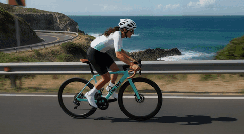
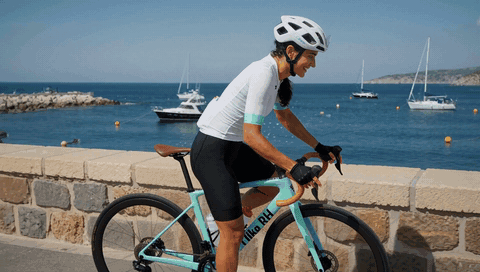
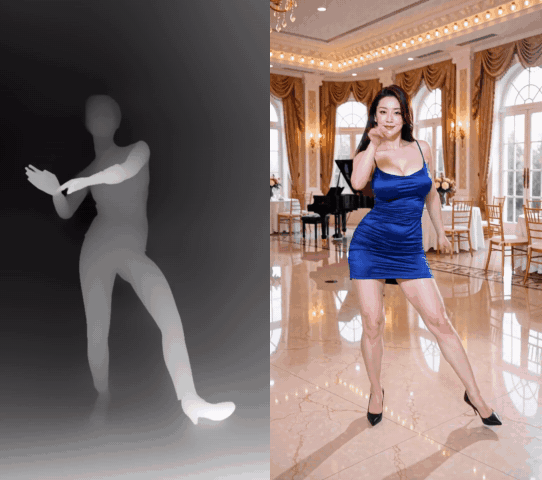
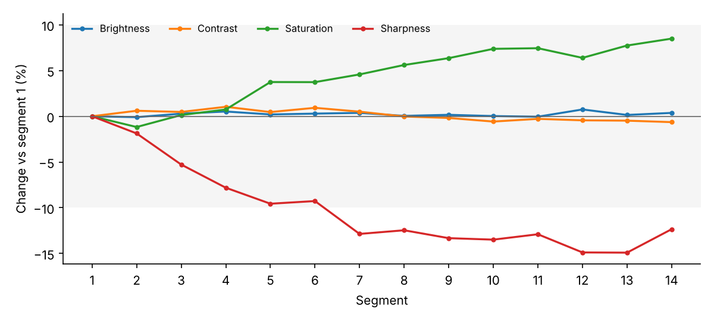

# H3MD Director

**English** | [中文](README.zh-CN.md)

Long, multi-shot MiniMax H3 video in ComfyUI — **2+ minutes at 1080p in one run**. Plan shots in a visual Director;
continued shots are rendered together on one seamless timeline (**0.4.0: CCW, Chained Context Windows**), every finished
part is kept on disk, and you repair only what went wrong — down to a few seconds.

> H3MD does **not** include any MiniMax H3 weights; the model has its own license (see [NOTICE.md](NOTICE.md)).

## Samples

| 2K, one segment (2560×1408, 15 s) | 1080p long take (1920×1088, 2 min 29 s, excerpt) |
|:---:|:---:|
|  |  |
| **Multi-shot story** (1080p, 2 min 19 s, excerpt) | **Motion copy**: depth map → result (1088×1920, 2 min 13 s, excerpt) |
|  |  |
| **Music video**: lip-synced to a locked song (1920×1088, 2 min 40 s, excerpt) | **Music video**: empty aerial shot, the song keeps playing (excerpt) |
|  |  |
| **Multi-person swap (0.6.0)**: the source - three dancers (28.5 s, excerpt) | **Multi-person swap**: the same clip with three new characters - motion, lips, blackout and place change kept (1664×960) |
|  |  |

## Highlights
- **Multi-person swap (0.6.0)**: replace 1-5 people in a real video with your own characters - the motion,
  camera, lip movement and sound stay. One keyframe workflow with buttons: link pictures to people on the cast panel,
  an AI writes the keyframe prompts, H3 Image redraws the keyframes, the Director runs Viggle Remake.
- **Seamless long video (0.4.0, CCW)**: tick one switch on the Director and continued shots are rendered together on one
  timeline with Chained Context Windows — no continuation seams, no drift, no double images; hard cuts stay clean.
- **Long video in one run**: 2–3 minutes at 1080p (measured: a 2 min 20 s music video at 1920×1088 in 2 h 18 min on an RTX 5090).
- **Watch it while it renders (0.6.5)**: the **H3MD Live Preview** window plays the model's current guess of the
  segment from the 3rd low-res step on - put it anywhere on the canvas, no wires; press Cancel if it goes wrong.
- **Repair instead of re-render**: the Control Panel's **redraw** box (or the **H3MD Redraw** node) redraws just a few seconds of a finished video (you may
  change that shot's prompt or pictures first); `rerun_segments` re-renders whole segments, locked to their neighbours.
- **Motion copy**: a reference video drives the motion (depth + SAM3 + Fun ControlNet); the look comes from your photos.
- **No long-video drift**: `lowres_anchor` keeps colors and faces stable over a whole single-scene take.
- **Fits your GPU**: automatic splitting by VRAM, high-res strip tiling, disk cache and resume; the optional 4B + ClipProj text encoder saves 10+ GB.

## Install

> [!IMPORTANT]
> **Install — run these two commands in a terminal, then restart ComfyUI:**
>
> ```bash
> cd ComfyUI/custom_nodes
> git clone https://github.com/1113800942/comfy-h3md-director ComfyUI-H3MD-Director
> ```
>
> Or with [comfy-cli](https://github.com/Comfy-Org/comfy-cli): `comfy node install comfyui-h3md-director`,
> or ComfyUI-Manager → **Custom Nodes Manager** → search **H3MD Director**.

1. No `pip install` is needed.
2. You need a ComfyUI version with MiniMax H3 support (0.43 or newer; **0.44 or newer for Seamless long video**).
3. Open an example workflow: ComfyUI **Templates** → `ComfyUI-H3MD-Director`, or drag one from
   [`example_workflows/`](example_workflows) into ComfyUI. **New here? Start with `H3MD Director simple`** (v0.3):
   only three things on the canvas – the **H3MD Control Panel** (size, fps / interpolation, face refine, seed, trial (which
   parts to run), style buttons Balanced / High motion / Motion copy, low-res and high-res LoRA lists), the
   **Director** (media, shots, prompts) and the video preview. Models, sampler and save settings sit in subgraphs
   (click to open). `H3MD Director` is the older flat full layout.
   Hardware: 40 / 50-series GPU with **16 GB VRAM minimum, 24 GB+ recommended** (measured on an RTX 5090; reports from
   16 / 24 GB cards welcome). On RunningHub and other platforms where subgraphs are awkward, unpack them first
   (right-click the subgraph node → Unpack). See **More** below for render times and the dependency table.
4. Missing node packs: ComfyUI-Manager → **Install Missing Custom Nodes**. Missing models: follow the
   **Model links** note inside the workflow (every file with its download link and folder).
5. **Prompts: write them with the [H3MD prompt skill](skills/h3md-prompt/SKILL.md).** Each shot is a full official H3
   prompt plus H3MD rules (5+17n lengths, overlaps, autosplit, tags, motion copy). Install it in Claude Code, Codex,
   Cursor or any agent that reads `SKILL.md`, together with MiniMax's official `h3-prompt-writing`:
   ```bash
   npx skills add https://github.com/1113800942/comfy-h3md-director --skill h3md-prompt
   npx skills add https://github.com/MiniMax-AI/MiniMax-H3 --skill h3-prompt-writing
   ```
   No agent? Paste the SKILL.md into any chat AI and ask it to write your shots.
6. **Fastest first run: the demo pack.** Download
   [`H3MD_demo_bluedress_seg1.zip`](https://github.com/1113800942/comfy-h3md-director/releases/download/0.2.0/H3MD_demo_bluedress_seg1.zip)
   (one 12 s shot: picture, music and all settings). On the H3MD Director click **Import plan…** → pick the zip →
   **Plan + all settings** → Run. Only the two-stage sampling (low-res + latent upscale) runs inside the Loop node;
   there is nothing else to set.
7. **Where H3MD reads and writes files** (v0.3.7, on every ComfyUI): media only from ComfyUI's input / output / temp
   folders (paths in a plan are relative to the input folder), videos only into the output folder (`output_folder`
   = a subfolder), the cache into a `<drive>/H3MD_cache` folder (chosen automatically) or ComfyUI's temp folder.
   Other folders: list them in `<ComfyUI user folder>/h3md/config.json`, e.g.
   `{"folders": ["D:/media", "E:/songs"]}`. **Shared or server ComfyUI** (started with `--listen`, a LAN address or a
   cloud platform): the cache always stays in ComfyUI's temp folder (each run its own; plan imports capped at 1 GB);
   force the mode with `"mode": "local"` / `"shared"` and allow reuse of cached segments with `"shared_resume": true`
   in the same file.

## Quick start
1. Put your photos, reference video and music into the Director, write the prompt per shot (use the
   [H3MD prompt skill](skills/h3md-prompt/SKILL.md)).
2. Set `stop_after = 1` on the Loop node and run only the first segment to check the look and speed.
3. Set it back to `0` with `resume_from_cache` on: segment 1 comes from the cache and the rest is generated.
4. A segment went wrong? Type its number in `rerun_segments` (e.g. `8-10`) and run again; only those are re-rendered.

```
H3MD Director --plan--> H3MD Loop Sampler (+ H3MD Loop Options) --long video--> H3MD Save Video Interp
```

## Seamless long video — CCW: Chained Context Windows (window mode)
0.4.0's main feature. ComfyUI's core Context Windows render a long video as overlapping windows and average the
overlaps; CCW runs the windows in time order and lets each window take over the overlap from the one before it, so
nothing is averaged and nothing doubles.

Tick **Seamless long video** at the top of the Director. Your plan stays exactly as it is; only how it is rendered
changes:
* Shots that continue each other are rendered **together on one timeline** with overlapping context windows, so there
  is **no continuation seam** and no drift from segment to segment.
* Hard cuts stay hard cuts (the windows break there, nothing is blended across a cut).
* Low-res windows are **chained** (接续窗口): they run in time order and a window takes over the overlap from the one
  before it instead of averaging two pictures, so there are no double images in the overlaps (`"chain": false` = the
  old averaging, with overlap 56).
* A very long plan is split into groups (about 60 s each) **only at a hard cut**, where the picture changes anyway.
  If one continuous take is longer than a group, the Director says where to put a hard cut.
* Each shot keeps its own prompt, pictures, reference video and music for its own time range; reference videos longer
  than H3's ~15 s limit work (each window gets its own slice).
* Lines and actions inside a long shot: write their time from the shot's start, the usual way
  (`At 00:07.9 she sings: <d>[English] ...</d>.`) or as `[8s] ...`; each one goes to the one window that holds that
  second, so nothing is sung or played twice (see the prompt skill).
* Inside one continuous take each shot is drawn from its own text only: write place, light and outfit in full in
  every shot (continued shots too) and give big changes a time. With 接续窗口 big changes inside a take (a spin, a back
  view turning to the front, running past changing scenery) no longer dissolve where windows overlap (11-08 tests:
  spin, back-to-front turn, a 22 s take with two hand-overs, a 12 s run along the sea). With `"chain": false` they can.
* Switched off automatically: depth / pose control (the video stays a normal reference video; also off in motion copy)
  and RefMods (identity comes from the reference pictures).
* Local redraw: see the steps below (the Control Panel's **redraw** box since 0.6.6, or the node **H3MD Redraw**; the plan key `"redraw"` does the same when written by
  hand). Watching a run: the **H3MD Live Preview** window (0.6.5; it replaces the old low-res-only `preview`).
* Frame interpolation (48 / 60 fps) never blends two shots at a hard cut: the frame between them repeats the nearest
  original frame (0.4.0; before, every hard cut got one frame of the two shots melted together).
* Memory: the result is decoded and written in ~10 s chunks, and the high-res pass plans its strips per window, so
  2K works on 64 GB RAM (measured: 21 s at 2560×1408 in 41 min on an RTX 5090).
* A locked song that is also `<Audio N>` gives each window only its own stretch of the song (not the whole file), and
  changing only high-res settings (high-res LoRAs, high-res windows) reuses the finished low-res pass.
* Segment numbers (`segments_to_run`, `rerun_segments`, `stop_after`) count **groups** in window mode, as the
  Director's notes list them (one group = the shots rendered together).
* About 25% slower than the old chain (11-08, 1920×1088: low-res about +11 %, high-res about +34 % per frame). Turn
  it off to get the old behaviour back exactly. Measured on an RTX 5090: a 2 min 20 s music video at 1920×1088
  (3 groups, 48 fps) took 2 h 18 min, compute VRAM peak 11.1 GB.

### Step by step
1. Tick **Seamless long video** on the Director. Keep `resume_from_cache` **on** on the Loop node (it is on in the
   example workflows; redraw and resume work from the cache).
2. *Watch it while it runs (0.6.5):* the **H3MD Live Preview** window node (in the example workflows, right of the
   other nodes; anywhere else works too, no wires) plays the segment as the model currently sees it, from the 3rd
   low-res step on, and the Loop node shows 8 frames of it. Nothing waits: if motion or framing is wrong, press
   Cancel - the finished steps stay in the cache. Settings: `live_preview` (low-res / low-res + high-res / off) and
   `live_preview_from_step` at the end of H3MD Loop Options. About 2 s per previewed step; tiny decoder taeh3
   (MIT, bundled), so the clip is softer than the result.
3. *Fix a few seconds:* write the seconds into the Control Panel's **redraw** box (0.6.6, above "trial"; the full
   workflow has no Control Panel: there use the bypassed **H3MD Redraw** node between the Director and the Loop,
   Ctrl+B to switch it on). The seconds are on the whole video's timeline: `20-24`,
   `1:12-1:15`, several ranges separated by commas. Run: only the windows that touch those seconds are rendered again,
   with a new seed; every other frame stays identical and the groups not touched come from the cache. Not happy? Run
   again (a new seed each time). Happy? Clear the box (or bypass the node): the redrawn take is kept.
   You may also edit the shot first: change its prompt, add or replace a picture (for example a still of the outfit
   from a shot where it came out right), or change its reference video or audio. Only the redrawn seconds use the
   change; the rest keeps the take you have. Not possible with a redraw: another size or length, moving a hard cut,
   another locked song. A redraw that starts at a hard cut is the safest place for bigger changes (nothing to match on
   the left side).
4. *A whole group is wrong:* type its number in `rerun_segments` (groups are numbered as the Director's notes list
   them).
5. *Stopped, crashed, or the PC restarted:* run again. Finished groups come from the cache; the interrupted group
   continues from the sampling step it was in (tested: the result is frame-identical to an uninterrupted run).

### Cache: what is kept and how big
* Where: `<drive>/H3MD_cache/resume_<id>/` (the drive with the most free space, or the `cache_dir` you set).
* Per group: the decoded frames (`seg_XXX_frames.npy`), the final latent (about 0.2 GB per minute), and in `seg_XXX_progress/` the
  low-res result `pass1.pt` (about 130 MB per 50 s group, kept so a preview, a redraw or a high-res-only change skips
  the low-res pass). Resume files of the current step exist only while a group runs.
* Frame size: the example workflows store them as 8-bit (`cache_dtype = uint8` in Loop Options): 6.3 MB per
  1920×1088 frame, about **9 GB per minute** of video (the 2 min 20 s video above: about 21 GB). Compared on that
  video: the saved video differs by at most 1/255 in a pixel value and an H.264 file of either is equally close to it
  (40.7 dB) - no visible difference. Use `fp16` (12.5 MB per frame, about 18 GB per minute; the node's own default)
  when you save 10-bit video (`yuv420p10le`), and keep `fp16` for a video you started with it: the cache format is
  part of the resume settings, so switching mid-way re-renders every group.
* Example: the 2 min 20 s video above left a 41 GB cache folder (fp16).
* Every redraw moves the previous take of that group to `_replaced_<time>/` in the same folder (a full copy of the
  group: about 15 GB for a 53 s group at 1920×1088). Delete those folders when you have chosen.
* H3MD never deletes the cache on its own: turn on `delete_cache_after_save` on H3MD Save Video Interp, or delete the
  `resume_...` folder by hand when the video is final.

## Multi-person swap (0.5.0, Viggle Remake)

Replace several people in a real video with your own characters ("picture 1 replaces the second person from the left"),
keeping the motion, camera, lip movement and soundtrack. The Director runs Viggle Remake's swap model in the low-res
pass and its own high-res pass on top.

1. **Keyframes + plan** (0.6.0): open `example_workflows/H3MD_Keyframe_MultiSwap_0.6.0.json` - one workflow, two
   groups, everything by buttons.
   - **Group 1 - Keyframe Export.** Drag the source video into *Source video* (optional `start_s` / `end_s` on Prepare:
     recast only that part, cut with its sound), the characters into *Picture 1/2/3*, leave
     *mapping* empty - picture 1 goes to the first person who appears in the clip, picture 2 to the next, and so on (people
     who appear together: left to right); once given, a person keeps his picture wherever he moves, later people stay
     themselves. After the run a **cast panel** appears under Prepare: the pictures on one side, the numbered people on
     the other, joined by lines (the machine's guess). Drag a line from a picture to a person to change it, click a
     line to remove it. **One picture can take several numbers**: if the tracker split one person into two numbers
     (after a cut, a turn, a crossing), drag a second line from the same picture - both numbers become one person.
     Numbers without a line stay themselves. Run again - the tracking is reused, so it takes seconds. *Descriptions*
     are optional: the AI describes each character from the picture and asks you what the picture does not show (a
     half-body picture: trousers and shoes). **H3MD Keyframe Prepare** tracks the people (core SAM3.1), finds the cuts
     and picks the keyframe moments only where the picture needs one (the start, each shot cut, a person coming in or
     back, people changing places, one large clear one per person; never a close-up
     the edit model cannot redraw, never a frame where the people are too dark to read; a person lost after a
     blackout, a cut or a spin is found again). A stretch where nothing new happens keeps one keyframe: the Director's
     carried frames take the swapped people from one part into the next. **H3MD Keyframe Export** writes
     `output/H3MD_keyframes/<name>_keyframe_export_<date>_<no>.zip` (never overwritten) and previews its keyframes.
   - **Give the zip to an AI** (Claude, ChatGPT, Gemini ... - one that reads pictures well) with the skill
     `skills/h3md-keyframe` (the package also carries a short version). It reads every keyframe - who goes where, both
     hands, legs, head, overlaps, crop - and answers with `<name>_keyframe_import_<date>_<no>.h3kf` (or a `.json`
     if it cannot make files). This reading decides the result: MiniMax H3 Image draws what the text says.
   - **Group 2 - Keyframe Import** (bypass group 1). Click **Import package** on H3MD Keyframe Import and pick the
     answer. **H3MD Keyframe Recast** redraws every keyframe with MiniMax H3 Image (int8, 4 MP, the tuned 6-step
     sigmas; ~25 s a keyframe on a 5090) and shows **Compare** - original | new, numbered. A keyframe that clearly
     differs: tell the AI its number and what is wrong, import its new answer, click that number on **H3MD Keyframe
     Redo** and run - only that one is made again. **H3MD Keyframe Assemble** writes
     `output/H3MD_plans/<name>_multiswap_plan_<date>_<no>.zip`; its global prompt is the LMS trigger words.
   Remake follows the keyframes closely: nothing in a keyframe may differ visibly from the source (person, place,
   clothes, body turn, both hands, overlaps); small differences are pulled back by Remake.
2. **Plan**: import the .zip in the Director (locally or on RunningHub).
3. **Run**: open `example_workflows/H3MD Director Remake.json` (Control Panel style **多人换人**, the Loop's
   `remake_model` wired to the Remake model; the style switches on only the LMS LoRA). Try the first part
   (试镜 1) before the whole clip.
   **Both models stay on - they do not conflict**: the low-res pass uses the Remake model (the swap happens there),
   the high-res pass uses the usual H3 base (it only adds detail). They take turns on the GPU; turning either one off
   breaks the run. The simple and full workflows have the same Remake model node, already wired to the Loop: the
   Control Panel style **多人互换** switches it on, every other style switches it off (so it is never loaded otherwise).

Needs (install yourself): the node pack **ComfyUI-Viggle-Remake** and the model
`viggle_remake_swap_pruned_int8_convrot.safetensors` in `models/diffusion_models`, both from Hugging Face
[Viggle/Viggle-Remake](https://huggingface.co/Viggle/Viggle-Remake) (see its model card for the licence). Limits:
output 1664x960 or 960x1664 (or 2560x1472) - the Director switches to it by itself if the Control Panel says otherwise; 90-345 frames per part (autosplit does it); up to 4 keyframes per part;
window mode is off for these plans. Works best when each recast person and their character are close in hair length,
build and gender; with big differences it is not perfect, but usable. Thanks to Viggle for releasing Remake.

**What it can and cannot do.** The keyframe workflow has to know who is who in every moment (people tracking plus
faces), so the source decides how far it goes:
- **Works well:** a fixed or steady camera (a stage, a dance or band performance, a group singing), people who may
  move around and be briefly hidden but soon show their faces again. Shot cuts between such shots are fine.
- **Not perfect - check the cast panel and the keyframes, sometimes a person gets the wrong picture:** many people
  crossing and changing places close to the camera, faces right up against the lens, people walking in and out all the
  time. The tracker can split one person into two numbers or lose someone for a moment; Prepare never uses such frames
  as keyframes, but a wrong match can remain.
- **Not supported:** music videos with edited-in effects - a person changing clothes from one frame to the next, a face
  morphing into another person's, transitions that blend two people. There the source frame itself holds two people at
  once, so no keyframe can say who it is.
- **GPU: 16 GB VRAM or more.** The Director cuts the video into parts that fit your GPU and starts a part on a
  keyframe where it can; a part that starts between keyframes continues from the 39 frames carried over from the part
  before, so the plan does not depend on the GPU. Below 16 GB it is not supported. A stretch made only of close-ups cannot hold a
  keyframe at all; if a part has to start there, the Director names the second in its notes.

## Ref Splice: several moves from one reference video, your own characters (0.6.2)

One reference clip often holds several moves you want in a different order, played by your own characters. The
**H3MD Ref Splice** node is a small video editor for that (example workflow `H3MD_Ref_Splice_0.6.2.json`):

1. Drag the reference video into **Load Video**; optionally connect your character pictures to `picture_1..5`.
2. **Run once**: a draft edit appears (the video cut where the motion pauses) and, with pictures, the cast panel
   (the people of the video; drag a line from a picture to the person it replaces — default: picture 1 = first
   person to appear).
3. **Edit on the node**: the upper track ("where in the source") only lets you drag the striped ends of a block -
   where a move starts / ends; the yellow line is the playhead (drag it to see any frame; "Split" cuts there). The lower track ("play order") is for the order: drag to reorder,
   duplicate a move, add transitions; where two moves touch, dragging their shared edge moves the cut between them, and a move can be split at the playhead or merged with the next; Undo / Reset are at the top. Click a transition
   to write what happens in it (the orange box). The nodes player shows only the edit: **▶ Play the edit** plays it straight away, without a run (watch the original on the Load Video node).
4. **Run**: the spliced preview plays on the node, a plan package `output/H3MD_plans/ref_splice_<date>_<NNN>.zip`
   is written (never overwritten; its full path shows in the **Plan package** box next to the node, ready to copy), and the `video` output carries the spliced video — connect **Save Video** to keep
   the edit as a finished file without H3. Not right? Change it and run again.
5. **Better prompts (recommended)**: the node cannot see the picture, so its prompts are plain. Hand the package to
   your AI with the H3MD skill (part 14b): it reads `ai/edit.json` and the stills in the package, asks about anything
   the pictures do not show (trousers, shoes), rewrites every prompt and returns `<name>_ai_<date>_<NNN>.zip`.
6. Drag the package into the **H3MD Director** (or Import plan) and run the low-res preview first. Without pictures
   the plan keeps the people of the video; what a transition does is up to you.

Transitions (measured): no words = the model links the two poses itself (about 1 s). A transition **with words**
is generated as its own short shot WITHOUT the reference video, carried by 39 frames on both sides - inside the
reference the model copied the placeholder (a double exposure, a frozen pose) and ignored the words; on its own it
did the clap, the crouch and the shout (2026-11-23). One simple move (kneel, crouch, clap, shout) needs about 1.5 s.
Write the words in English as one full sentence with who does it (or let the AI step write them from the package).
Moves can land 0.3–0.5 s early - it is a link, not frame-exact choreography.

Swapping people here is the plain reference swap (pictures + the reference video). It holds well, but in a wild move where the replaced person is low on the floor with the face hidden, the original person can come back for about a second (2026-11-23: same place with another seed). Cut or shorten that move, or use the multi-person swap (Remake) when the swap must hold everywhere. A half-body picture shows no trousers or shoes: say what they are, or the original person's keep showing.

A move has no text box: it plays exactly as in the source. Words only go into a transition (empty = a plain link; filled = goes into the prompt) - that is where a new move goes.

## Reporting a problem

In the H3MD Director click **Report 诊断报告** (next to Export plan) and attach the .zip from `output/H3MD_reports/`
to your [GitHub issue](../../issues). It holds what we need to find the cause: GPU, VRAM (and the peak of the last
run), versions of ComfyUI / torch / H3MD and the related node packs, which models were found, every node's settings
by name and whether the node is on, bypassed or muted (`settings.md`), the key switches (tiling, cache, LoRAs ...) and
what differs from the shipped example workflow, a
check of the plan against the prompt-skill rules (lengths, window handoffs, Remake keyframes...) and the last runs'
H3MD log and error. It has no user or computer names, no folders (paths are cut to file names) and no pictures,
videos or audio; untick **prompts** to leave the prompts out. It is only saved on your machine.

## More (click to open)

<details>
<summary><b>What it does</b></summary>

* **Multi-segment continuation**: `H3MD Loop Sampler` runs every shot/segment of the Director plan. Continued shots
  start from the tail of the previous segment's final latent (`overlapIn` 22 or 39 frames, drift: lightly re-noised
  while sampling, restored exactly at the end); hard cuts (`overlapIn` 0) are generated independently. Shots over the
  token budget are auto-split into sub-segments.
* **Two-pass sampling, bundled**: every segment runs through `H3MD Sampler`, built on the bundled Luna-H3-Sampler
  engine (GPL-3.0): the first steps at low resolution, a learned H3 latent upscaler lifts the video, the rest at full
  resolution. Audio is one trajectory across both passes.
* **Automatic high-res tiling**: with `highres_tiling` (default on) each segment measures the free VRAM and runs the
  full frame when it fits, otherwise the fewest strips that fit. On a CUDA out-of-memory error the high-res pass is
  retried with more strips (the low-res result is kept) and the machine remembers it for next time.
* **Disk cache + resume**: with `cache_mode = disk` (default) each segment is decoded and written to disk right away,
  so RAM holds one segment. With `resume_from_cache` on, re-queueing skips finished segments and reuses the base
  seed of the cached run.
* **Streamed save**: `long video` → `H3MD Save Video Interp` reads, (optionally) RIFE-interpolates and encodes the
  frames chunk by chunk, with bounded RAM.
* **Director console**: `H3MD Director` has a built-in visual editor (asset bin, timeline, shot tabs, @-mentions,
  thumbnails on picture tags).
* **Motion transfer**: `H3MD Depth Control` turns a reference video into depth / SAM3 person silhouettes for the
  Fun ControlNet and `<Video N>`.

</details>

<details>
<summary><b>Install details and dependencies</b></summary>

1. Put the folder at `custom_nodes/ComfyUI-H3MD-Director`
   (`git clone https://github.com/1113800942/comfy-h3md-director custom_nodes/ComfyUI-H3MD-Director`, or copy it).
2. Install the node packs you need (table below), then restart ComfyUI.
3. No extra `pip install`: H3MD only uses torch, numpy, PyAV, Pillow and einops, which ship with ComfyUI.
4. Recommended: a learned latent upscaler in `models/latent_upscale_models/`, e.g.
   `minimax_h3_latent_upscaler_3d_fp16.safetensors` or a fine-tune such as
   `h3_upscaler_lms_v0.1_fp32.safetensors` (= the older `h3_upscaler_sharpness_2000steps_v0.1_fp32.safetensors`). Without one, set `upscaler_model = none` (nearest, softer).

**Example workflows**
* `H3MD Director simple.json` — **start here** (v0.3): Control Panel + Director + preview; models / sampler / save in
  subgraphs; since 0.6.6 every node in it is H3MD's own or ComfyUI core (the bypassed TARA node for motion copy is the only third-party one). Low VRAM: swap the 32B text encoder for 4B +
  ClipProj (the full workflow has the ClipProj node bypassed; see the text encoder notes below).
* `example_plans/h3md_silver_warrior_1min_v3.zip` — a ready-to-import **1-minute fight** plan (9 shots, 1280×704, no media
  needed): in the Director click **Import plan…**, pick the zip, choose "Plan only". Made for the Control Panel's "high
  motion" style (one weapon LoRA per pass).
* `H3MD Director.json` — the full setup used for the samples; has the face refine and frame interpolation switches
  on the canvas (both off as shipped), one extra refine step and a few convenience nodes.
* `H3MD Director Remake.json` + `H3MD_Keyframe_MultiSwap_0.6.0.json` - the multi-person swap: the second
  makes the keyframes (with an AI, see "Multi-person swap") and the plan .zip, the first runs it.
* `example_plans/H3MD_multiswap_3dancers_0.6.0_plan.zip` - a finished **multi-person swap** plan (three dancers,
  28.5 s, two place changes, a blackout; source clip and 14 recast keyframes included): open `H3MD Director
  Remake.json`, click **Import plan…** in the Director, pick the zip and run.

| Node pack | What it does in the workflows | Needed? | Without it |
|---|---|---|---|
| ComfyUI 0.43+ (core MiniMax H3 nodes; 0.44+ for Seamless long video) | models, sampler, VAE | **required** | — |
| H3MD Director (this pack) | Director, Loop Sampler, Save Video Interp, depth / SAM3 motion copy | **required** | — |
| [ComfyUI-KJNodes](https://github.com/kijai/ComfyUI-KJNodes) + the SageAttention package (2.x) | SageAttention: faster attention with less VRAM. The `H3MD Sage Attention` node calls KJNodes' patch and shows on the node whether it is active; when it is not, its "How to install" button lists the steps. The chunked feed-forward patch is built into H3MD since 0.6.6 | recommended | no error: the node passes the model through, the render is slower and needs more VRAM |
| [ComfyUI-ClipProj](https://github.com/nicolab28/ComfyUI-ClipProj) | 4B text encoder projection, saves 10+ GB VRAM | only with the 4B encoder | use the 32B encoder |
| RIFE frame interpolation | `interpolate` in the Control Panel / `H3MD Save Video Interp` (24 → 30 / 48 / 60 fps) | **built in since 0.6.3** (network + weights ship with H3MD, MIT) | nothing to install; off as shipped |
| VOSR 2.0 (face restore) | face refine in `H3MD Save Video Interp` | **built in since 0.6.6** (code from ComfyUI-VOSR2, Apache-2.0). The model files (about 7 GB) download on first use into `models/vosr2/VOSR2`; an external VOSR 2.0 loader can still be wired to `vosr2_model` (the full workflow does) | nothing to install; face refine is off as shipped. If the files cannot be downloaded the video is saved without the restore step and the report says why |
| SAM3.1 (`sam3.1_multiplex_fp16.safetensors` in `checkpoints/`, ComfyUI core) | face refine (0.5.3): finds the head on the face crop; H3 then redraws inside it. The save node's `redraw_model` / `redraw_clip` / `redraw_vae` / `redraw_audio_vae` take the sampler's H3 model (with the 768 turbo LoRA), text encoder and VAEs (wired in the examples) | needed for face refine | keep `face_refine` off |
| Face tracking and paste-back (ComfyUI-H3-FaceRefine 1.1.2 by Carasibana, MIT) + face detector | face refine: finds and follows the lead face (`detector`), pastes the refined face back | **built in since 0.6.6**, with its own face detector (`face_yolov8n_v2`, ships with H3MD): no ultralytics / insightface install and no detector download. Only extras load on demand: another detector file from `models/ultralytics/bbox/` needs the `ultralytics` package, `cut_detection = auto` needs `scenedetect` | nothing to install |
| [ComfyUI-H3-FaceRefine-Plus](https://github.com/AnniCodex/ComfyUI-H3-FaceRefine-Plus) (AnniCodex, MIT) | face refine save node, optional inputs `stitch_mode = plus` (antialiased paste, light from the original, detail from the refined face) and `flow_lock` (pins the refined features back onto the original frames, less face wobble); needs opencv-python | optional | leave both at their defaults (`standard` / off); if the pack is missing the node falls back and says so in the report |
| [ComfyUI-SeedVR2_VideoUpscaler](https://github.com/numz/ComfyUI-SeedVR2_VideoUpscaler) | face refine with `refine_model = SeedVR2`: its DiT / VAE loaders go to `seedvr2_model` / `seedvr2_vae` (TE-Speed SeedVR2 also works) | optional | use VOSR2, or keep `face_refine` off |
| T8 semantic bridge (MiniMax H3 prompt enhancer T8) | its "Semantic Bridge" config or multi-bridge stack can go straight into the Loop's `semantic_bridge` input (same math as our own bridge node) | optional | our H3MD Semantic Bridge node (in the example workflows: wired, bypassed - select it and press Ctrl+B to use it; the style buttons no longer switch a bridge on). The bridge's author does not recommend it with reference pictures or lip-sync to a reference audio |
| Sigma refiner (one extra refine step) | `H3MD Sigma Refiner` | **built in since 0.6.6** (same numbers as YCNodes' `H3SigmaRefiner`) | nothing to install |
| [rgthree-comfy](https://github.com/rgthree/rgthree-comfy) | Power Lora Loader (many LoRAs in one node) and the title labels | full only, optional | the simple and Remake workflows use only H3MD and ComfyUI core nodes |
| ComfyUI-Dehypnotic, Crystools, Easy-Use, LayerStyle, CRT-Nodes | aspect-ratio picker, switch, number, VRAM purge, timer | full only, optional | not needed to render |

Frame interpolation and face refine are **off in every example workflow**; turn them on when you want them. Interpolation needs nothing else (built in since 0.6.3). Face refine needs no other pack since 0.6.6 (only SAM3.1 and, on first use, the VOSR 2.0 download); if something is missing the video is saved without face refine and the report says why.
ComfyUI lists any missing pack when a workflow opens (ComfyUI-Manager → **Install Missing Custom Nodes**).

**Recommended LoRAs (all optional).** The Control Panel's style buttons use these. They are suggestions, not
requirements: a LoRA you do not have shows as "not downloaded" and is skipped (no error), and you can switch any row
off or pick your own. Keep the authors' file names or rename them as you like - since 0.6.6 the panel recognises a
file by its size and SHA256, not by its name. All go in `models/loras/`.

| File (official name) | Used for | Source |
|---|---|---|
| `H3_Combat_V2.safetensors` | fights | huggingface.co/JOKER141/MiniMax-H3-Combat-Base-V2 |
| `Bunny_weapon_combatV1.safetensors` | weapon fights | huggingface.co/JOKER141/MiniMax-H3-Weapon-Combat-LoRA |
| `H3_Fight_Flow_V1.safetensors` | fight interaction | huggingface.co/JOKER141/H3-Fight-Flow-Fight-Interaction-LoRA |
| `Motion_Repair_V2.safetensors` | motion continuity | civitai.com/models/2890788 (V2; the Hugging Face repo JOKER141/MiniMax-H3-General-Motion-Continuity-Repair holds V1, a different file) |
| `H3-Licon-VBVR-I2V.safetensors` | motion / physics | huggingface.co/LiconStudio/Minimax-H3-VBVR |
| `MiniMaxH3_Enhancer_minimaxh3_3432130_epoch_10.safetensors` | detail | civitai.com/models/3025511 |
| `h3-realism-people-t2v-i2v-r2v.safetensors` | realistic people | huggingface.co/fal/MiniMax-H3-Realism-People-LoRA |
| `minimax_h3_lms_v1.0_r64.safetensors` | sharpness (lms) | huggingface.co/Alissonerdx/Minimax-H3-ComfyUI, folder `loras/` |

</details>

<details>
<summary><b>Hardware and render time (measured)</b></summary>

Measured on one machine: **RTX 5090 32 GB**, Ryzen 9 9950X3D, **64 GB RAM**, ComfyUI 0.43, PyTorch 2.13 + CUDA 13.0;
hybrid b25-49 int8 model, 32B int8 text encoder, 4-step turbo LoRAs, two-pass sampling (6 low-res + 3 high-res steps).

| Resolution | One ~15 s segment | 2 min 40 s video | High-res strips | Peak system RAM | Disk cache (whole video) |
|---|---|---|---|---|---|
| 704×1280 | about 4 min | 47 min (12 segments) | 1–2 | about 54 GB | about 22 GB |
| 1088×1920 / 1920×1088 | about 8–12 min | about 1.5–2 h (11 segments) | 2–3 | about 35 GB | about 70 GB |

* The first segment of a run takes about a minute longer (model loading).
* Model files: base model 19.5 GB; 32B text encoder 25.3 GB (or 4B encoder 5.3 GB + ClipProj 0.5 GB); video VAE
  4.9 GB; audio VAE 0.6 GB; each turbo LoRA 0.3–1.8 GB. Plan for about 55 GB of models plus the cache.
* **4B encoder + ClipProj vs 32B** (704×1280, same seed): same picture quality and the same speed (203 s vs 199 s per
  segment); it only saves VRAM (10+ GB) and follows detailed prompts a little less closely.
* The cache is about 3 GB per 243 frames at 1088×1920 (fp16); delete it after saving (`delete_cache_after_save`).
* **Only tested on an RTX 5090.** Smaller cards should start with the 4B encoder + ClipProj, 704×1280, segments of about
  10 s and few, small reference pictures (see **Low VRAM**). The tiling estimate learns your card after its first
  out-of-memory retry.
* Please post your GPU, resolution and time per segment in
  [Discussions](https://github.com/1113800942/comfy-h3md-director/discussions); we will add them to this table.

</details>

<details>
<summary><b>Save and share a plan (Export plan / Import plan…)</b></summary>

The row above the Director's plan header (shown even on an empty Director):
* **Export plan + media** — one plain `.zip` with the plan, the whole workflow (every node setting: LoRAs and
  strengths, seed, Loop Options, Save settings), a readable settings list, a first-frame thumbnail of the newest
  finished video, and the pictures and songs. For yourself: re-open a recipe that worked, swap the photo, change a
  length, run again. Reference videos over 200 MB are added only with "incl. big ref video" ticked.
* **Export plan (no media)** — the same without pictures and songs, to share a recipe without anyone's photos or music.
* **Import plan…** — a `.zip` from above, or a plan `.json` written by an agent with the
  [H3MD prompt skill](skills/h3md-prompt/SKILL.md) (section 12b). Media go to `input/H3MD_plans/<name>/` (never
  overwritten). **Plan only** replaces this Director's plan; **Plan + all settings** opens the saved workflow in a new
  tab through ComfyUI's normal loader, so missing node packs show red and missing models open the usual download
  dialog. Problems (lengths that are not 5 + 17n, wrong overlaps, `<Picture N>` tags with no picture, missing files)
  are listed, never fixed silently.

Never inside: finished videos, caches, model weights, RefMod files (they are listed in `manifest.json`).
Format: [docs/plan_format.md](docs/plan_format.md).

</details>

<details>
<summary><b>Re-render only the bad segments (rerun_segments)</b></summary>

When a few segments of a finished video are bad (jumps, glitches), do not re-render the whole video:
1. Keep `resume_from_cache` on and the other settings unchanged; reference pictures and prompts may change (**keep the
   total length and the reference pictures' pixel size**, otherwise the automatic split changes).
2. In `rerun_segments` (top of the Loop node) list the segments, 1-based as in the log ("segment 8/16"): `3`, `4-6`,
   `8-10, 13-14`.
3. Each block starts from the end of the segment before it; its last 39 frames are locked to the start of the cached
   segment after it (high-res, low-res and audio), so that segment and everything after it stay untouched. No tail lock
   for the last segment or before a hard cut. Select neighbouring bad segments together (e.g. 8-10); the locked end
   must be a good one.
4. All other segments come from the cache and the output is still the whole video. Old files of re-rendered segments
   are moved to `_replaced_<time>` inside the cache folder.
5. `rerun_new_seed` (default on): re-rendered segments get a new random seed.
The log lists every segment as "cache" or "RERUN (head/tail)" first; a missing cached segment stops the run with a list.

</details>

<details>
<summary><b>Long-video drift and lowres_anchor</b></summary>

This is common to every chained H3 continuation; it can be held down, not removed. Measured over 16 segments:
saturation 0.32 -> 0.46 and rising sharpness. The colour drift is born in the **low-res pass** (the model continuing its
own result) as a slow shift of the 24 latent channels' mean and spread.
* One continuous scene (motion copy, a long take): set `lowres_anchor` (near the end of `H3MD Loop Options`) to 1. After
  each continued segment's low-res pass, before the upscale, the new frames' channel statistics are pulled back to the
  shot's first segment, and the low-res carry is corrected too, so the error does not reach the next segment. Needs
  `continue_lowres_prefix = native_lowres_carry`. Not for a story whose colours should change (a hard cut starts a new
  reference).
* v0.2.0: `hires_anchor` (now the last widget of `H3MD Loop Options`) does the same on the high-res result, which the
  next segment also continues from. Small gain on its own (5 segments, same seed: colour shift 0.29 -> 0.13, sharpness
  −10.6 % -> −7.6 %, saturation unchanged), so it is off by default.
* v0.2.0: **`drift_correct = auto`** on the save node (H3MD Save Video Interp / Face Refine) fixes what is left, in
  pixel space, while the video is written. The cache is not changed, so switch it off and save again to compare.
  * **How it decides.** A hard cut always starts a new reference. Inside a shot, a clear change of brightness,
    contrast or colour (night falls, indoors -> outdoors) also starts a new reference: drift does not do that (3-minute
    take: brightness within 0.7 %, contrast 1 %, colour shift < 1 over 14 segments). Then, per stretch with the same
    reference, saturation and sharpness are corrected only when they follow a clear, steady trend (drift creeps a
    little every segment); values that jump around with the content (a dancer, someone walking in) are left alone.
    Only the drift is removed, smoothed over neighbouring segments; sharpness is only ever raised back, never blurred.
    Stretches of 1–2 segments are not touched. Every decision and the reason: `<video>_drift.json`.
  * **Measured.** 3-minute single take (saved through the node from its cache): saturation +8.4 % -> at most +1.5 %,
    sharpness −18 % -> at most +3.1 %, brightness and contrast unchanged. 11-shot music video (all hard cuts): nothing
    changed. A 16-segment dance (motion copy): only a gentle 2–6 % colour pull, sharpness untouched. A synthetic day ->
    night shot: the night part was recognised as a new scene and kept dark. It is a guess from measurements: check the
    report and switch it off for a film where it guessed wrong.
  * Finished videos (or not made with H3MD): [`tools/drift_correct.py`](tools/drift_correct.py)
    `video.mp4 --segments 294,362,362,362:0,362` (`:0` = hard cut) or `--plan workflow.json` (plans without autosplit).
  * Related work: the same "pull back to scene one in RGB" idea is in matlowai's ComfyUI-MAINodes (H3 Delta Color
    Carry) and its source, NikoDemon80 / ethanfel's ComfyUI-MiniMaxH3-Contex-Loop (latent_color_carry); they correct
    the carried prefix *before* the next segment is sampled. No code from them is used here.
* Also: give every segment the reference photos; avoid over-saturated / over-sharp reference photos; avoid lighting
  adjectives (glowing, radiant ...) in prompts; restart very long pieces from the reference photos at natural cuts.


**Measured: a 3-minute single take** ([video](https://youtu.be/ewb1Ui5OIfs)). 3:07, locked-off camera, no cuts: 14
segments chained through the 39-frame latent overlap, 704×1280, `lowres_anchor = 1`. Every segment is compared with
the first one using [`tools/drift_report.py`](tools/drift_report.py) (run it on your own videos):

| Segment | Time | Brightness % | Contrast % | Saturation % | Sharpness % | Colour shift |
|---:|---|---:|---:|---:|---:|---:|
| 1 | 0.0–12.2 s | +0.0 | +0.0 | +0.0 | +0.0 | 0.00 |
| 2 | 12.2–25.7 s | -0.1 | +0.6 | -1.2 | -1.9 | 0.24 |
| 3 | 25.7–39.2 s | +0.3 | +0.5 | +0.1 | -5.3 | 0.31 |
| 4 | 39.2–52.6 s | +0.5 | +1.0 | +0.7 | -7.8 | 0.29 |
| 5 | 52.6–66.1 s | +0.2 | +0.5 | +3.7 | -9.6 | 0.31 |
| 6 | 66.1–79.5 s | +0.3 | +0.9 | +3.7 | -9.3 | 0.35 |
| 7 | 79.5–93.0 s | +0.4 | +0.5 | +4.6 | -12.9 | 0.45 |
| 8 | 93.0–106.5 s | +0.0 | -0.0 | +5.6 | -12.5 | 0.49 |
| 9 | 106.5–119.9 s | +0.2 | -0.2 | +6.4 | -13.3 | 0.58 |
| 10 | 119.9–133.4 s | +0.0 | -0.6 | +7.4 | -13.5 | 0.72 |
| 11 | 133.4–146.8 s | -0.0 | -0.3 | +7.4 | -12.9 | 0.69 |
| 12 | 146.8–160.3 s | +0.7 | -0.4 | +6.4 | -14.9 | 0.63 |
| 13 | 160.3–173.8 s | +0.1 | -0.5 | +7.7 | -14.9 | 0.74 |
| 14 | 173.8–187.2 s | +0.4 | -0.6 | +8.5 | -12.3 | 0.69 |



* Brightness and contrast stay within 1 %; the colour shift stays under 1 (not visible).
* Saturation creeps up about 8.5 % and levels off after about 2 minutes. For comparison, the same kind of chain
  **without** `lowres_anchor` went from 0.34 to 0.48 saturation (about +40 %).
* Sharpness drops 10–15 %: the picture gets slightly **softer**, not over-sharpened or older. Segment 1 is the
  instrumental intro with little motion, so it is the sharpest reference.
* **It is not zero drift.** But over 3 minutes the face, the scene and the light stay the same. Test your own setup
  with the script.

</details>

<details>
<summary><b>Motion copy (depth) rules</b></summary>

* A video with depth ticked **drives only the depth ControlNet and is not a `<Video N>` reference** (automatic, no
  switch); the Director gives it no `<Video N>` number. Reason: a black-background silhouette as `<Video N>` was copied
  into the picture (black / grey studio). A depth video with its soundtrack on stays a `<Video N>` (warning).
* Depth ticked without `H3MD Depth Control` connected: error before the run.
* **No plain / grey studio backgrounds in reference photos** (measured: with no `<Video>` reference a grey-backdrop
  photo still pulled the video grey). Use real-location photos or cut the person onto a blurred target location; keep
  the floor out of full-body photos and describe one plain floor in the prompt.

</details>

<details>
<summary><b>Using the main features</b></summary>

**`H3MD Director`**
* `plan_json` is the single source of truth: the editor reads it and writes every edit back. Editor / JSON toggle top right.
* Asset bin: upload or pick files from `input/`; drag an item onto a shot to assign it.
* Shot lengths are 5+17n frames at 24 fps; a shot with a reference video follows the clip. Width and height snap to
  multiples of 64, so the low-res pass is exactly half size.
* Type `@` or click a tag chip to insert a media tag (`<Picture N>` / `<Video N>` / `<Audio N>`), in backend order.
* **Check what each `<Picture N>` shows before writing its role** (the tag chips show a thumbnail): the person, the
  outfit and the location must each point to the picture that really contains it. Calling an empty scene picture
  "the person" makes the video jump to another background or outfit midway. See `skills/` (EN / 中文).

**`H3MD Loop Sampler` + `H3MD Loop Options`**
* Main node: models, sampler, sigmas, seed, cfg, `transition_step` (low-res steps), `lowres_scale`, `rho` / `w_min` /
  `w_max`, `upscaler_model`, `seed_mode` (default increment: segment k uses seed + k), `highres_tiling`,
  `rerun_segments` / `stop_after` / `rerun_new_seed` (top of the node), `cache_mode`, `resume_from_cache`.
* Advanced switches live in `H3MD Loop Options`, linked to `options`; not linked = defaults. The node shows the common
  options; tick "advanced" to see all.
* Outputs: `latent`, `images` (64x64 placeholder), `audio`, `frame_count`, `summary` (per segment: seed, tiling plan,
  step times), `long video`.
* **Connect `long video` to `H3MD Save Video Interp`** — the only save path designed for bounded VRAM/RAM.

**Disk cache**
* Folders: `resume_<hash>` (stable with `resume_from_cache` on) or `run_<time>_<pid>`.
* Location: with `cache_dir` empty it is chosen automatically (an existing `H3MD_cache` → the local drive with the
  most free space). A set `cache_dir` must be inside a `<drive>/H3MD_cache` folder, ComfyUI's output / temp folder or
  a folder listed in `h3md/config.json` (v0.3.7).
* The Loop never deletes its cache before the video is saved; use `delete_cache_after_save` in
  `H3MD Save Video Interp`. A 243-frame 1088x1920 segment takes about 3 GB (fp16).

**`H3MD Save Video Interp`**
* H3 is fixed at 24 fps. With `interpolate` on, RIFE goes from 24 to `target_fps`; with it off and `target_fps` ≠ 24
  the clip plays faster/slower and the audio no longer matches (logged).
* `format`: `video/h264-mp4` (default), `video/h265-mp4`, `image/gif`, `image/webp`, `image/png-sequence` (the last
  three have no audio).
* Chunk size follows free VRAM/RAM; on CUDA OOM the chunk is halved and retried, finally on the CPU.

</details>

<details>
<summary><b>Low VRAM</b></summary>

* **High-res pass**: keep `highres_tiling` on. It picks the strip count from the free VRAM (up to 12) and runs the full
  frame whenever it fits, so it costs nothing on large cards. On CUDA OOM it retries with more strips, then with
  feed-forward chunking, and only then stops with a readable error.
* **Low-res pass**: not tiled. On OOM the error suggests `ff_chunk_rows = 8192` in H3MD Loop Options (feed-forward in
  row chunks: same result, slightly slower).
* **Reference media do not shrink with more strips**: reference images / videos, audio and text are whole in every
  strip. Measured at 1088x1920 with 2 pictures + 1 reference video: ~37k fixed rows per strip. On **cards under 16 GB
  use a lower resolution** (e.g. 768x1344 or smaller), shorter segments and fewer / smaller reference media.
* **Model weights** are left to ComfyUI's memory management (DynamicVRAM, `--lowvram`, `--reserve-vram N`);
  H3MD LowVRAM LoRA Loader loads LoRAs in token chunks.
* `unload_idle_models` (default on) unloads text encoder / VAEs between the passes and between segments;
  `vram_release = deep` also clears caches between segments.
* The estimate is calibrated on an RTX 5090 32 GB; after the first OOM on your machine it is recorded in
  `user/h3md/tiling_calibration.json` and later runs plan more strips automatically.

</details>

<details>
<summary><b>Models manifest</b></summary>

the example workflow has a top-level `models` array (ComfyUI workflow spec,
<https://docs.comfy.org/specs/workflow_json>): `name`, `url`, `directory` (required), `hash` / `hash_type` (optional).
When a listed file is missing from `models/<directory>/`, the frontend's missing-models popup offers a download button.
Limits: Hugging Face / Civitai URLs only; extensions `.safetensors` / `.sft` / `.ckpt` / `.pth` / `.pt` only;
`directory` must be a registered models folder; **`name` must match the node's widget value exactly**, otherwise that
entry is not shown.

| name | directory | source |
|---|---|---|
| `minimax_h3_hybrid_fl2va_ref2va_b25-49-int8.safetensors` | `diffusion_models` | huggingface.co/smhfacct/Minimax-H3-fl2va-ref2va-hybrid-models |
| `Huihui-Qwen3-VL-4B-Instruct-abliterated-int8_convrot.safetensors` | `text_encoders` | huggingface.co/ahmed22xa/Huihui-Qwen3-VL-4B-Instruct-abliterated-comfy |
| `minimax_h3_video_vae_fp16.safetensors` | `vae` | huggingface.co/Comfy-Org/MiniMax-H3 |
| `minimax_h3_audio_vae_fp32.safetensors` | `vae` | huggingface.co/Comfy-Org/MiniMax-H3 |
| `mmh3-4b-ClipProj-v3.1-mlp.safetensors` | `clip_projections` | huggingface.co/NicoLab28/ClipProj-MiniMax-H3 |
| `h3_upscaler_lms_v0.1_fp32.safetensors` | `latent_upscale_models` | huggingface.co/Alissonerdx/Minimax-H3-ComfyUI, folder `latent_upscaler/` (the same file as the older name `h3_upscaler_sharpness_2000steps_v0.1_fp32.safetensors`, now in `experiments/` - same sha256; keep whichever you have) |
| `Motion_Repair_V2.safetensors` | `loras` | FourBunny's "BUNNY General Motion Continuity Repair" V2: civitai.com/models/2890788 (the Hugging Face repo JOKER141/MiniMax-H3-General-Motion-Continuity-Repair holds V1, a different file) |
| `H3_Combat_V2.safetensors` | `loras` | huggingface.co/JOKER141/MiniMax-H3-Combat-Base-V2 |
| `minimax_h3_fl2v_turbo_4step_v1.2_768p_comfyui_bf16.safetensors` | `loras` | huggingface.co/lightx2v/Minimax-h3-Turbo |
| `sam3.1_multiplex_fp16.safetensors` | `checkpoints` | huggingface.co/Comfy-Org/sam3.1 |
| `minimax_h3_lms_v1.0_r64.safetensors` | `loras` | huggingface.co/Alissonerdx/Minimax-H3-ComfyUI, folder `loras/` (not the RunningHubAI `..._r64_r` file, which is a different file) |

Each model has its own license; check its model page before use. The `ClipProjApply` entry only shows when ComfyUI-ClipProj is installed.

</details>

<details>
<summary><b>Caveats and known issues</b></summary>

* For large / long videos the `latent` / externally decoded images / `audio` paths do **not** guarantee against
  VRAM/RAM blowups; a one-pass external decode can also differ slightly at the seams. Only `long video` →
  `H3MD Save Video Interp` is designed for bounded VRAM/RAM.
* The `images` output is a 64x64 placeholder (except with `cache_mode = ram`).
* Old workflows: removed options (`merge_images`; Save Video Interp's `preset` / `cache_folder` / `pingpong` / `fps`
  output, etc.) are re-aligned by name and dropped on load, nothing else shifts; `H3MD Loop Sampler (legacy)` is kept
  so old saves load.
* `video/h265-mp4` and 10-bit (`yuv420p10le`) are **untested**.
* The `resume_from_cache` key does not cover models, LoRAs or the upscaler; after changing them turn resume off or
  clear the cache folder.
* This version changed the sampling engine: older caches are not resumed, and an old workflow's `H3MD Loop Options`
  node should be deleted and re-added (its options changed).
* **Text encoder**: 32B (`qwen3vl_32b_minimax_h3_int8_convrot`) follows prompts best. Short on VRAM? Use 4B
  (`qwen3vl_4b_fp8_scaled`, Load CLIP type `krea2`) + ClipProj: it saves 10+ GB with no loss in image quality, only
  slightly weaker prompt understanding (details can differ a little from 32B). Measured on ComfyUI 0.44 (RTX 5090,
  64 GB): it encodes much more slowly (29 s per encode against 5 s with 32B; window mode encodes every window) and
  peak RAM / VRAM were almost the same (51 / 29.7 GB against 50 / 30.9 GB), because ComfyUI streams the 32B from
  disk. Use it when the 32B does not load at all. **Keep one encoder for a whole piece**; do not switch when re-rendering
  segments with `rerun_segments`.
* **Fast-motion ghosting**: a fast arm swing can briefly show ghost hands (4 frames are packed into 1 latent step, plus
  few sampling steps). Re-render that segment with a new seed via `rerun_segments`.
* A motion-copy plan is aligned to the reference video (rounded up to 5+17n); trim the frames past the reference video
  after export.

</details>

<details>
<summary><b>How H3MD works (ideas you can reuse) and thanks</b></summary>

MiniMax H3 makes at most ten-odd seconds per run. For a 2–3 minute video the hard part is not "can the clips join" but
keeping a dozen joined segments **seamless, drift-free, within VRAM, and repairable**. These are the problems we hit and
how we solved them — feel free to build on them.

### 1. Continue in latent space, not pixels
- **Problem**: decoding the previous clip and re-encoding it as the next reference softens and shifts color a little at
  every join.
- **Approach**: the next segment starts with the **last 39 frames of the previous segment's final latent** (held by
  noise mask 0); only the first few frames are lightly re-noised during sampling and restored exactly at the end.
  Overlaps are merged from the later segment.

### 2. Two-pass sampling with a native low-res carry
- Half resolution for 6 steps, a learned latent upscaler, then 3 steps at full resolution (engine from
  Luna-H3-Sampler).
- **Native low-res carry**: the next segment's low-res head is the previous segment's **own low-res result**, not a
  downscale of the high-res output, so both chains stay continuous.

### 3. Automatic splitting and tiling by VRAM
- Every shot is estimated in tokens (canvas + reference videos + pictures); shots over the budget are split into equal
  continuation parts, with cut points moved to quiet moments of the reference video.
- The high-res pass runs the whole frame when it fits and the fewest strips when it does not; on OOM it retries with
  more strips and remembers the machine.
- Slow-step guard: a step 4× slower than usual means VRAM ran out (weights streaming), so the run stops with the cache
  kept.

### 4. Disk cache, resume, and re-rendering only the bad segments
- Each segment is decoded and written to disk right away; only one segment is in RAM. A re-queue skips finished
  segments.
- **Re-render selected segments**: a selected segment's head continues the segment before it and its **tail is locked
  to the next segment's old head** (high-res latent, low-res result and audio), so the replacement is seamless at both
  ends and nothing else changes. No 5-hour rerun for one glitch.

### 5. Motion copy: depth drives only the ControlNet
- For intense moves, the third-party **TARA** motion-transfer LoRA (Alissonerdx, with ComfyUI-BFSNodes) works with an H3MD
  workflow as ordinary extra nodes: the source video as a normal `<Video 1>` (depth not ticked), the TARA LoRA, the BFS
  TARA node on the low-res model only, `motion_transfer:` in the prompt, and bypass the simple workflow's "Sage low-res" node (Sage stops
  TARA). The simple workflow already has both TARA nodes in the model subgraph (bypassed, with a note): the Control Panel's "motion copy" button switches them on and bypasses "Sage low-res" ("balanced" / "high motion" switch back). TARA is not part of this node pack: install ComfyUI-BFSNodes (Manager → Install Missing Custom Nodes) and the LoRA (missing-models popup) yourself.
  Shot length in motion copy: a shot that follows the source video takes its length from the video, aligned to H3's
  5+17n frames. With `motion_transfer:` in the prompt it is rounded **down** at the clip end (TARA needs a source frame
  for every frame, so up to 0.7 s of the clip end is left out); in every other use it is rounded **up** as before.
  You never set it yourself, and the prompt's `Duration:` line is updated automatically.
  Since 0.4.6 a guide video that ends up to 16 frames before its shot (the shot was rounded up) keeps its last frame to
  the shot's length, in segment and window mode, so a missing `motion_transfer:` no longer ends in the TARA "identical
  temporal grids" error; and with the Control Panel style on "motion copy" the trigger is added to the plan's global
  prompt when it is queued, if the plan has none (your workflow text is not changed).

- Reference video → Depth Anything V2 depth → SAM3 keeps only the person → Fun ControlNet, **on the low-res pass
  only**.
- **Lesson from testing**: feeding the white-on-black silhouette as a `<Video N>` reference as well made the model copy
  the black background or a grey studio into the picture. Depth video now drives only the ControlNet.

### 6. What reference photos leak into the video (measured)
- Grey / plain studio backgrounds → the video drifts into a grey studio. Fix: cut the person out onto a blurred version
  of the target location.
- A wide toothy grin in the photo → a frozen grin in every frame. Fix: say "identity from the photo, not the
  expression".
- Wooden floors, tiles, mirrors → a different pattern in every segment. Fix: describe one plain floor.

### 7. Long-video drift: pull the low-res pass back per channel (`lowres_anchor`)
- **Problem**: segment after segment, colors deepen, sharpness grows and faces look older. Every chained H3 continuation
  method in the community shows this.
- **Diagnosis**: measuring the low-res and final latents of a 16-segment cache separately showed the color drift is
  **born in the low-res pass** (saturation 0.39 → 0.58); the high-res pass only adds a constant offset. The drift is a
  slow shift of the 24 latent channels' mean and spread.
- **Fix**: after each low-res pass, before the upscale, the new frames' per-channel mean and spread are pulled back to
  the **first segment of the shot**, and the low-res carry is corrected too, so the error never reaches the next segment.
- **Result**: over a 133 s take saturation stays at 0.33–0.36 (0.34 → 0.48 without it); sharpness stops climbing and
  faces stop aging.
- **Dead end we took first**: grading new frames to the previous segment's held frames did nothing — those frames had
  already drifted. **The anchor must be a source that has not drifted.**

### 8. Text encoder: 32B vs 4B + ClipProj
- 4B + ClipProj saves 10+ GB of VRAM with no loss in image quality, only slightly weaker prompt understanding. Fine for
  generating from scratch; don't switch encoders in the middle of one piece.

### 9. CCW: Chained Context Windows (0.4.0)
- **Problem**: joining segments (1.) leaves a small seam at every join and lets drift build up. ComfyUI's core Context
  Windows sample a whole take at once in overlapping windows, but they **average the overlaps**: where the picture
  changes a lot (a spin, a back view turning to the front), two different pictures averaged become double images — our
  2 min 20 s test showed five such spots.
- **Approach**: in the low-res pass the windows run in time order, and a window's overlap with the windows before it
  takes their result of the same step (input and output) instead of averaging. Same amount of computation. The high-res
  pass keeps averaged windows (the picture is already set there).
- Hard cuts are window boundaries (nothing is blended across a cut), and long plans are grouped (about 60 s) only at
  hard cuts. Each window gets its own share of the prompt: lines with a time (`At 00:07.9 ...`, `[8s] ...`) go to the one
  window that draws that second, and reference pictures follow the windows that mention them.
- **Result**: the five double-image spots of the 2:20 test are gone; about 25 % slower than joining segments.

### 10. Local redraw: a noise mask over the finished take
- Only the windows that touch the chosen seconds are sampled; everything else is held by a noise mask, the low-res pass
  keeps the take's **own** low-res result on the kept rows, and only the changed decode chunks are decoded. The previous
  take is moved to `_replaced_<time>/`, so nothing is lost.
- **Lessons from testing**: soft, blended edges gave double exposure → hard edges; using a shrunk final latent as the
  low-res base washed the picture out → the take's own low-res result.

### 11. Method
- **Search the community before testing**: a GPU runs only a few tests a day.
- **Measure**: per-segment saturation and Laplacian sharpness plus face crops, not "it feels like".
- **Analyze the cache offline**: it holds every segment's low-res and final latent, so you can find the guilty stage
  without using the GPU.

### Thanks 👍
H3MD stands on many shoulders. Their code, models or openly shared findings gave us direct ideas:

**Engine, models and nodes**
- 👍 [MiniMax](https://huggingface.co/MiniMaxAI) for open-sourcing H3, and [Comfy-Org](https://huggingface.co/Comfy-Org/MiniMax-H3) for native ComfyUI support
- 👍 [Comfy-Org](https://github.com/comfyanonymous/ComfyUI): the core Context Windows for MiniMax H3 that CCW builds on (the context-window idea goes back to Kosinkadink's [AnimateDiff-Evolved](https://github.com/Kosinkadink/ComfyUI-AnimateDiff-Evolved) context options)
- 👍 [Luna-H3-Sampler](https://github.com/lunaaispace-eng/Luna-H3-Sampler): two-pass sampling engine (bundled, GPL-3.0)
- 👍 [LBH-123-AI](https://huggingface.co/LBH-123-AI/Minimax_h3_latent_Upscaler): learned latent upscaler (MIT)
- 👍 [Alissonerdx](https://huggingface.co/Alissonerdx/Minimax-H3-ComfyUI): latent upscaler (lms, formerly named sharpness) and lms LoRA
- 👍 [nkxx188/ComfyUI-MiniMaxH3-Easy](https://github.com/nkxx188/ComfyUI-MiniMaxH3-Easy): high-res strip tiling idea (MIT)
- 👍 [Kijai](https://github.com/kijai/ComfyUI-KJNodes): SageAttention / feed-forward VRAM patches, DMAD conversion
- 👍 [NicoLab28/ClipProj](https://github.com/nicolab28/ComfyUI-ClipProj): 4B encoder projection for small GPUs
- 👍 [alibaba-pai Fun ControlNet](https://huggingface.co/alibaba-pai/MiniMax-H3-Fun-Controlnet-Union), [Depth Anything V2](https://github.com/DepthAnything/Depth-Anything-V2), [SAM3](https://huggingface.co/Comfy-Org/sam3.1): the three pillars of motion copy
- 👍 [smhfacct](https://huggingface.co/smhfacct/Minimax-H3-fl2va-ref2va-hybrid-models) (fl2va × ref2va hybrid), [t8star](https://huggingface.co/t8star) (curveproj-compatible LoRAs), [lightx2v](https://huggingface.co/lightx2v/Minimax-h3-Turbo) (Turbo LoRA), [DMAD](https://huggingface.co/ZhengmingYu/DMAD), [fal](https://huggingface.co/fal/MiniMax-H3-Realism-People-LoRA) (realism people), [JOKER141](https://huggingface.co/JOKER141/MiniMax-H3-Combat-Base-V2) (Combat LoRA)

**Long-video drift: people who shared their findings**
- 👍 [tritant/ComfyUI_MiniMax_H3_Extender](https://github.com/tritant/ComfyUI_MiniMax_H3_Extender): documented "contrast rises at every extension" and that reference images carry color in
- 👍 [NikoDemon80/ComfyUI-H3-Motion-Context](https://github.com/NikoDemon80/ComfyUI-H3-Motion-Context): latent continuation instead of pixel round trips, and "less sharpening in the last step"
- 👍 [mark9009/ComfyUI-H3-LongTake](https://github.com/mark9009/ComfyUI-H3-LongTake): measured keyframe anchoring and seam color matching
- 👍 [EchoHeadache/comfyui-aex-drift](https://github.com/EchoHeadache/comfyui-aex-drift): handoff matching and seam anchoring. We moved the anchor to the first segment, but it is what made us see that the anchor must not drift
- 👍 [roycho87/clown_context_suite](https://github.com/roycho87/clown_context_suite): periodic clean anchors
- 👍 The author of the [10-link chaining measurement](https://dev.to/nefayran/chaining-image-to-video-clips-from-the-last-frame-what-10-links-did-to-a-face-minimax-h3-46e0) on dev.to, who put numbers on aging faces and sharpness overshoot

### Special thanks 👍
t8star, JOKER141 (Bunny), TE MAN and many other creators, for their long-running free tutorials for the community — outstanding work and generously shared ideas and experience. Hats off to them!

Thank you for sharing what you learned. H3MD will keep sharing its findings back with the community.

</details>

Full node and option reference: [docs/technical-reference.md](docs/technical-reference.md).

## License
ComfyUI-H3MD is Copyright (C) 2026 YJ and licensed under the GNU Affero General Public License v3.0 or
later (SPDX `AGPL-3.0-or-later`) with one additional term: keep a visible attribution "Based on H3MD Director (ComfyUI-H3MD-Director) by
YJ" when you distribute it or offer it as an online service. Commercial use is allowed; a modified version offered over
a network must publish its source. Full text in [LICENSE](LICENSE), details in [NOTICE.md](NOTICE.md); the bundled
Luna-H3-Sampler code in `h3md_luna/` is GPL-3.0 ([LICENSES/](LICENSES/)).
