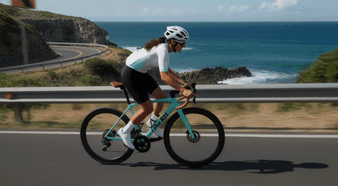
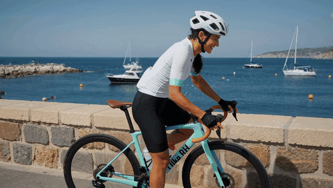
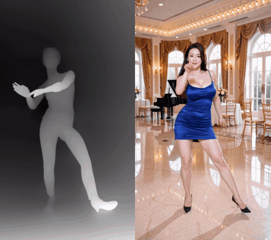

# H3MD Director

**English** | [中文](README.zh-CN.md)

Long, multi-shot MiniMax H3 video in ComfyUI — **2+ minutes at 1080p in one run**. Plan shots in a visual Director,
generate them segment by segment, keep every finished segment on disk, and repair only what went wrong.

> H3MD does **not** include any MiniMax H3 weights; the model has its own license (see [NOTICE.md](NOTICE.md)).

## Samples

| 2K, one segment (2560×1408, 15 s) | 1080p long take (1920×1088, 2 min 29 s, excerpt) |
|:---:|:---:|
|  |  |
| **Multi-shot story** (1080p, 2 min 19 s, excerpt) | **Motion copy**: depth map → result (1088×1920, 2 min 13 s, excerpt) |
|  |  |

## Highlights
- **Long video in one run**: 2–3 minutes at 1088×1920, split automatically into seamlessly continued segments.
- **Repair instead of re-render**: `rerun_segments` re-renders only the bad segments, locked to their neighbours at both ends.
- **Motion copy**: a reference video drives the motion (depth + SAM3 + Fun ControlNet); the look comes from your photos.
- **No long-video drift**: `lowres_anchor` keeps colors and faces stable over a whole single-scene take.
- **Fits your GPU**: automatic splitting by VRAM, high-res strip tiling, disk cache and resume; the 4B + ClipProj encoder saves 10+ GB.

## Install

> [!IMPORTANT]
> **Install — run these two commands in a terminal, then restart ComfyUI:**
>
> ```bash
> cd ComfyUI/custom_nodes
> git clone https://github.com/1113800942/comfy-h3md-director ComfyUI-H3MD-Director
> ```

1. No `pip install` is needed.
2. You need a ComfyUI version with MiniMax H3 support (0.43 or newer recommended).
3. Open the example workflow: ComfyUI **Templates** → `ComfyUI-H3MD-Director` → **H3MD Director**, or drag
   [`example_workflows/H3MD Director.json`](example_workflows/H3MD%20Director.json) into ComfyUI.
4. Missing node packs: ComfyUI-Manager → **Install Missing Custom Nodes**. Missing models: follow the
   **Model links** note inside the workflow (every file with its download link and folder).

## Quick start
1. Put your photos, reference video and music into the Director, write the prompt per shot.
2. Set `stop_after = 1` on the Loop node and run only the first segment to check the look and speed.
3. Set it back to `0` with `resume_from_cache` on: segment 1 comes from the cache and the rest is generated.
4. A segment went wrong? Type its number in `rerun_segments` (e.g. `8-10`) and run again; only those are re-rendered.

```
H3MD Director --plan--> H3MD Loop Sampler (+ H3MD Loop Options) --long video--> H3MD Save Video Interp
```

## More (click to open)

<details>
<summary><b>What it does</b></summary>

* **Multi-segment continuation**: `H3MD Loop Sampler` runs every shot/segment of the Director plan. Continued shots
  start from the tail of the previous segment's final latent (`overlapIn` 22 or 39 frames, drift: lightly re-noised
  while sampling, restored exactly at the end); hard cuts (`overlapIn` 0) are generated independently. Shots over the
  token budget are auto-split into sub-segments.
* **Two-pass sampling, bundled**: every segment runs through `H3MD Sampler`, built on the bundled Luna-H3-Sampler
  engine (GPL-3.0): the first steps at low resolution, a learned H3 latent upscaler lifts the video, the rest at full
  resolution. Audio is one trajectory across both passes.
* **Automatic high-res tiling**: with `highres_tiling` (default on) each segment measures the free VRAM and runs the
  full frame when it fits, otherwise the fewest strips that fit. On a CUDA out-of-memory error the high-res pass is
  retried with more strips (the low-res result is kept) and the machine remembers it for next time.
* **Disk cache + resume**: with `cache_mode = disk` (default) each segment is decoded and written to disk right away,
  so RAM holds one segment. With `resume_from_cache` on, re-queueing skips finished segments and reuses the base
  seed of the cached run.
* **Streamed save**: `long video` → `H3MD Save Video Interp` reads, (optionally) RIFE-interpolates and encodes the
  frames chunk by chunk, with bounded RAM.
* **Director console**: `H3MD Director` has a built-in visual editor (asset bin, timeline, shot tabs, @-mentions,
  thumbnails on picture tags).
* **Motion transfer**: `H3MD Depth Control` turns a reference video into depth / SAM3 person silhouettes for the
  Fun ControlNet and `<Video N>`.

</details>

<details>
<summary><b>Install details and dependencies</b></summary>

1. Put the folder at `custom_nodes/ComfyUI-H3MD-Director`
   (`git clone https://github.com/1113800942/comfy-h3md-director custom_nodes/ComfyUI-H3MD-Director`, or copy it).
2. Install the node packs below, then restart ComfyUI.
3. No extra `pip install`: H3MD only uses torch, numpy, PyAV, Pillow and einops, which ship with ComfyUI.
4. Recommended: a learned latent upscaler in `models/latent_upscale_models/`, e.g.
   `minimax_h3_latent_upscaler_3d_fp16.safetensors` or a fine-tune such as
   `h3_upscaler_sharpness_2000steps_v0.1_fp32.safetensors`. Without one, set `upscaler_model = none` (nearest, softer).

Dependencies:
* **ComfyUI** with the core MiniMax H3 nodes (`comfy_extras.nodes_minimax_h3`), 0.43 or newer recommended.
* **selflift-Avatar is no longer needed**: the two-pass engine is bundled (`h3md_luna/`).
* **ComfyUI-ClipProj** (<https://github.com/nicolab28/ComfyUI-ClipProj>) — clip projection model used by the example.
* **ComfyUI-VFI** (<https://github.com/GACLove/ComfyUI-VFI>) — only for RIFE interpolation in `H3MD Save Video Interp`.
* The example workflow also uses ComfyUI-KJNodes, rgthree-comfy, MiniMax H3 Audio T8, CRT-Nodes and
  ComfyUI-YCNodes-MiniMax-H3; ComfyUI lists any missing pack when the workflow opens.

</details>

<details>
<summary><b>Re-render only the bad segments (rerun_segments)</b></summary>

When a few segments of a finished video are bad (jumps, glitches), do not re-render the whole video:
1. Keep `resume_from_cache` on and the other settings unchanged; reference pictures and prompts may change (**keep the
   total length and the reference pictures' pixel size**, otherwise the automatic split changes).
2. In `rerun_segments` (top of the Loop node) list the segments, 1-based as in the log ("segment 8/16"): `3`, `4-6`,
   `8-10, 13-14`.
3. Each block starts from the end of the segment before it; its last 39 frames are locked to the start of the cached
   segment after it (high-res, low-res and audio), so that segment and everything after it stay untouched. No tail lock
   for the last segment or before a hard cut. Select neighbouring bad segments together (e.g. 8-10); the locked end
   must be a good one.
4. All other segments come from the cache and the output is still the whole video. Old files of re-rendered segments
   are moved to `_replaced_<time>` inside the cache folder.
5. `rerun_new_seed` (default on): re-rendered segments get a new random seed.
The log lists every segment as "cache" or "RERUN (head/tail)" first; a missing cached segment stops the run with a list.

</details>

<details>
<summary><b>Long-video drift and lowres_anchor</b></summary>

This is common to every chained H3 continuation; it can be held down, not removed. Measured over 16 segments:
saturation 0.32 -> 0.46 and rising sharpness. The colour drift is born in the **low-res pass** (the model continuing its
own result) as a slow shift of the 24 latent channels' mean and spread.
* One continuous scene (motion copy, a long take): set `lowres_anchor` (last widget of `H3MD Loop Options`) to 1. After
  each continued segment's low-res pass, before the upscale, the new frames' channel statistics are pulled back to the
  shot's first segment, and the low-res carry is corrected too, so the error does not reach the next segment. Needs
  `continue_lowres_prefix = native_lowres_carry`. Not for a story whose colours should change (a hard cut starts a new
  reference).
* Also: give every segment the reference photos; avoid over-saturated / over-sharp reference photos; avoid lighting
  adjectives (glowing, radiant ...) in prompts; restart very long pieces from the reference photos at natural cuts.

</details>

<details>
<summary><b>Motion copy (depth) rules</b></summary>

* A video with depth ticked **drives only the depth ControlNet and is not a `<Video N>` reference** (automatic, no
  switch); the Director gives it no `<Video N>` number. Reason: a black-background silhouette as `<Video N>` was copied
  into the picture (black / grey studio). A depth video with its soundtrack on stays a `<Video N>` (warning).
* Depth ticked without `H3MD Depth Control` connected: error before the run.
* **No plain / grey studio backgrounds in reference photos** (measured: with no `<Video>` reference a grey-backdrop
  photo still pulled the video grey). Use real-location photos or cut the person onto a blurred target location; keep
  the floor out of full-body photos and describe one plain floor in the prompt.

</details>

<details>
<summary><b>Using the main features</b></summary>

**`H3MD Director`**
* `plan_json` is the single source of truth: the editor reads it and writes every edit back. Editor / JSON toggle top right.
* Asset bin: upload or pick files from `input/`; drag an item onto a shot to assign it.
* Shot lengths are 5+17n frames at 24 fps; a shot with a reference video follows the clip. Width and height snap to
  multiples of 64, so the low-res pass is exactly half size.
* Type `@` or click a tag chip to insert a media tag (`<Picture N>` / `<Video N>` / `<Audio N>`), in backend order.
* **Check what each `<Picture N>` shows before writing its role** (the tag chips show a thumbnail): the person, the
  outfit and the location must each point to the picture that really contains it. Calling an empty scene picture
  "the person" makes the video jump to another background or outfit midway. See `skills/` (EN / 中文).

**`H3MD Loop Sampler` + `H3MD Loop Options`**
* Main node: models, sampler, sigmas, seed, cfg, `transition_step` (low-res steps), `lowres_scale`, `rho` / `w_min` /
  `w_max`, `upscaler_model`, `seed_mode` (default increment: segment k uses seed + k), `highres_tiling`,
  `rerun_segments` / `stop_after` / `rerun_new_seed` (top of the node), `cache_mode`, `resume_from_cache`.
* Advanced switches live in `H3MD Loop Options`, linked to `options`; not linked = defaults. The node shows the common
  options; tick "advanced" to see all.
* Outputs: `latent`, `images` (64x64 placeholder), `audio`, `frame_count`, `summary` (per segment: seed, tiling plan,
  step times), `long video`.
* **Connect `long video` to `H3MD Save Video Interp`** — the only save path designed for bounded VRAM/RAM.

**Disk cache**
* Folders: `resume_<hash>` (stable with `resume_from_cache` on) or `run_<time>_<pid>`.
* Location: with `cache_dir` empty it is chosen automatically (env `H3MD_CACHE_DEFAULT` → an existing `H3MD_cache` →
  the local drive with the most free space).
* The Loop never deletes its cache before the video is saved; use `delete_cache_after_save` in
  `H3MD Save Video Interp`. A 243-frame 1088x1920 segment takes about 3 GB (fp16).

**`H3MD Save Video Interp`**
* H3 is fixed at 24 fps. With `interpolate` on, RIFE goes from 24 to `target_fps`; with it off and `target_fps` ≠ 24
  the clip plays faster/slower and the audio no longer matches (logged).
* `format`: `video/h264-mp4` (default), `video/h265-mp4`, `image/gif`, `image/webp`, `image/png-sequence` (the last
  three have no audio).
* Chunk size follows free VRAM/RAM; on CUDA OOM the chunk is halved and retried, finally on the CPU.

</details>

<details>
<summary><b>Low VRAM</b></summary>

* **High-res pass**: keep `highres_tiling` on. It picks the strip count from the free VRAM (up to 12) and runs the full
  frame whenever it fits, so it costs nothing on large cards. On CUDA OOM it retries with more strips, then with
  feed-forward chunking, and only then stops with a readable error.
* **Low-res pass**: not tiled. On OOM the error suggests `ff_chunk_rows = 8192` in H3MD Loop Options (feed-forward in
  row chunks: same result, slightly slower).
* **Reference media do not shrink with more strips**: reference images / videos, audio and text are whole in every
  strip. Measured at 1088x1920 with 2 pictures + 1 reference video: ~37k fixed rows per strip. On **cards under 16 GB
  use a lower resolution** (e.g. 768x1344 or smaller), shorter segments and fewer / smaller reference media.
* **Model weights** are left to ComfyUI's memory management (DynamicVRAM, `--lowvram`, `--reserve-vram N`);
  H3MD LowVRAM LoRA Loader loads LoRAs in token chunks.
* `unload_idle_models` (default on) unloads text encoder / VAEs between the passes and between segments;
  `vram_release = deep` also clears caches between segments.
* The estimate is calibrated on an RTX 5090 32 GB; after the first OOM on your machine it is recorded in
  `user/h3md/tiling_calibration.json` and later runs plan more strips automatically.

</details>

<details>
<summary><b>Models manifest</b></summary>

the example workflow has a top-level `models` array (ComfyUI workflow spec,
<https://docs.comfy.org/specs/workflow_json>): `name`, `url`, `directory` (required), `hash` / `hash_type` (optional).
When a listed file is missing from `models/<directory>/`, the frontend's missing-models popup offers a download button.
Limits: Hugging Face / Civitai URLs only; extensions `.safetensors` / `.sft` / `.ckpt` / `.pth` / `.pt` only;
`directory` must be a registered models folder; **`name` must match the node's widget value exactly**, otherwise that
entry is not shown.

| name | directory | source |
|---|---|---|
| `minimax_h3_hybrid_fl2va_ref2va_b25-49-int8.safetensors` | `diffusion_models` | huggingface.co/smhfacct/Minimax-H3-fl2va-ref2va-hybrid-models |
| `Huihui-Qwen3-VL-4B-Instruct-abliterated-int8_convrot.safetensors` | `text_encoders` | huggingface.co/ahmed22xa/Huihui-Qwen3-VL-4B-Instruct-abliterated-comfy |
| `minimax_h3_video_vae_fp16.safetensors` | `vae` | huggingface.co/Comfy-Org/MiniMax-H3 |
| `minimax_h3_audio_vae_fp32.safetensors` | `vae` | huggingface.co/Comfy-Org/MiniMax-H3 |
| `mmh3-4b-ClipProj-v3.1-mlp.safetensors` | `clip_projections` | huggingface.co/NicoLab28/ClipProj-MiniMax-H3 |
| `h3_upscaler_sharpness_2000steps_v0.1_fp32.safetensors` | `latent_upscale_models` | huggingface.co/Alissonerdx/Minimax-H3-ComfyUI |
| `H3_Combat_V2.safetensors` | `loras` | huggingface.co/JOKER141/MiniMax-H3-Combat-Base-V2 |
| `minimax_h3_DMAD_4step_full_lora_avg_rank_39_bf16.safetensors` | `loras` | huggingface.co/Kijai/MiniMax-H3-experimental |
| `minimax_h3_fl2v_turbo_4step_v1.2_768p_comfyui_bf16.safetensors` | `loras` | huggingface.co/lightx2v/Minimax-h3-Turbo |
| `minimax_h3_lms_v1.0_r64_r.safetensors` | `loras` | huggingface.co/RunningHubAI/rh-minimax-h3-lms-v1.0-r64-lora |

Each model has its own license; check its model page before use. The `ClipProjApply` entry only shows when ComfyUI-ClipProj is installed.

</details>

<details>
<summary><b>RIFE model (manual download)</b></summary>

the missing-models popup only downloads into registered `models/` folders and does not allow `.pkl`, so RIFE `flownet.pkl` is not in the manifest. Download it manually: node pack ComfyUI-VFI (<https://github.com/GACLove/ComfyUI-VFI>); model <https://huggingface.co/hzwer/RIFE/resolve/main/RIFEv4.26_0921.zip> — extract `flownet.pkl` to `custom_nodes/ComfyUI-VFI/rife/train_log/flownet.pkl` (relative to the ComfyUI root). ComfyUI-VFI normally downloads it itself on first use.

</details>

<details>
<summary><b>Caveats and known issues</b></summary>

* For large / long videos the `latent` / externally decoded images / `audio` paths do **not** guarantee against
  VRAM/RAM blowups; a one-pass external decode can also differ slightly at the seams. Only `long video` →
  `H3MD Save Video Interp` is designed for bounded VRAM/RAM.
* The `images` output is a 64x64 placeholder (except with `cache_mode = ram`).
* Old workflows: removed options (`merge_images`; Save Video Interp's `preset` / `cache_folder` / `pingpong` / `fps`
  output, etc.) are re-aligned by name and dropped on load, nothing else shifts; `H3MD Loop Sampler (legacy)` is kept
  so old saves load.
* `video/h265-mp4` and 10-bit (`yuv420p10le`) are **untested**.
* The `resume_from_cache` key does not cover models, LoRAs or the upscaler; after changing them turn resume off or
  clear the cache folder.
* This version changed the sampling engine: older caches are not resumed, and an old workflow's `H3MD Loop Options`
  node should be deleted and re-added (its options changed).
* **Text encoder**: 32B (`qwen3vl_32b_minimax_h3_int8_convrot`) follows prompts best. Short on VRAM? Use 4B + ClipProj:
  it saves 10+ GB with no loss in image quality, only slightly weaker prompt understanding (details can differ a little
  from 32B). Fine for generating from scratch. **Keep one encoder for a whole piece**; do not switch when re-rendering
  segments with `rerun_segments`.
* **Fast-motion ghosting**: a fast arm swing can briefly show ghost hands (4 frames are packed into 1 latent step, plus
  few sampling steps). Re-render that segment with a new seed via `rerun_segments`.
* A motion-copy plan is aligned to the reference video (rounded up to 5+17n); trim the frames past the reference video
  after export.

</details>

<details>
<summary><b>How H3MD works (ideas you can reuse) and thanks</b></summary>

MiniMax H3 makes at most ten-odd seconds per run. For a 2–3 minute video the hard part is not "can the clips join" but
keeping a dozen joined segments **seamless, drift-free, within VRAM, and repairable**. These are the problems we hit and
how we solved them — feel free to build on them.

### 1. Continue in latent space, not pixels
- **Problem**: decoding the previous clip and re-encoding it as the next reference softens and shifts color a little at
  every join.
- **Approach**: the next segment starts with the **last 39 frames of the previous segment's final latent** (held by
  noise mask 0); only the first few frames are lightly re-noised during sampling and restored exactly at the end.
  Overlaps are merged from the later segment.

### 2. Two-pass sampling with a native low-res carry
- Half resolution for 6 steps, a learned latent upscaler, then 3 steps at full resolution (engine from
  Luna-H3-Sampler).
- **Native low-res carry**: the next segment's low-res head is the previous segment's **own low-res result**, not a
  downscale of the high-res output, so both chains stay continuous.

### 3. Automatic splitting and tiling by VRAM
- Every shot is estimated in tokens (canvas + reference videos + pictures); shots over the budget are split into equal
  continuation parts, with cut points moved to quiet moments of the reference video.
- The high-res pass runs the whole frame when it fits and the fewest strips when it does not; on OOM it retries with
  more strips and remembers the machine.
- Slow-step guard: a step 4× slower than usual means VRAM ran out (weights streaming), so the run stops with the cache
  kept.

### 4. Disk cache, resume, and re-rendering only the bad segments
- Each segment is decoded and written to disk right away; only one segment is in RAM. A re-queue skips finished
  segments.
- **Re-render selected segments**: a selected segment's head continues the segment before it and its **tail is locked
  to the next segment's old head** (high-res latent, low-res result and audio), so the replacement is seamless at both
  ends and nothing else changes. No 5-hour rerun for one glitch.

### 5. Motion copy: depth drives only the ControlNet
- Reference video → Depth Anything V2 depth → SAM3 keeps only the person → Fun ControlNet, **on the low-res pass
  only**.
- **Lesson from testing**: feeding the white-on-black silhouette as a `<Video N>` reference as well made the model copy
  the black background or a grey studio into the picture. Depth video now drives only the ControlNet.

### 6. What reference photos leak into the video (measured)
- Grey / plain studio backgrounds → the video drifts into a grey studio. Fix: cut the person out onto a blurred version
  of the target location.
- A wide toothy grin in the photo → a frozen grin in every frame. Fix: say "identity from the photo, not the
  expression".
- Wooden floors, tiles, mirrors → a different pattern in every segment. Fix: describe one plain floor.

### 7. Long-video drift: pull the low-res pass back per channel (`lowres_anchor`)
- **Problem**: segment after segment, colors deepen, sharpness grows and faces look older. Every chained H3 continuation
  method in the community shows this.
- **Diagnosis**: measuring the low-res and final latents of a 16-segment cache separately showed the color drift is
  **born in the low-res pass** (saturation 0.39 → 0.58); the high-res pass only adds a constant offset. The drift is a
  slow shift of the 24 latent channels' mean and spread.
- **Fix**: after each low-res pass, before the upscale, the new frames' per-channel mean and spread are pulled back to
  the **first segment of the shot**, and the low-res carry is corrected too, so the error never reaches the next segment.
- **Result**: over a 133 s take saturation stays at 0.33–0.36 (0.34 → 0.48 without it); sharpness stops climbing and
  faces stop aging.
- **Dead end we took first**: grading new frames to the previous segment's held frames did nothing — those frames had
  already drifted. **The anchor must be a source that has not drifted.**

### 8. Text encoder: 32B vs 4B + ClipProj
- 4B + ClipProj saves 10+ GB of VRAM with no loss in image quality, only slightly weaker prompt understanding. Fine for
  generating from scratch; don't switch encoders in the middle of one piece.

### 9. Method
- **Search the community before testing**: a GPU runs only a few tests a day.
- **Measure**: per-segment saturation and Laplacian sharpness plus face crops, not "it feels like".
- **Analyze the cache offline**: it holds every segment's low-res and final latent, so you can find the guilty stage
  without using the GPU.

### Thanks 👍
H3MD stands on many shoulders. Their code, models or openly shared findings gave us direct ideas:

**Engine, models and nodes**
- 👍 [MiniMax](https://huggingface.co/MiniMaxAI) for open-sourcing H3, and [Comfy-Org](https://huggingface.co/Comfy-Org/MiniMax-H3) for native ComfyUI support
- 👍 [Luna-H3-Sampler](https://github.com/lunaaispace-eng/Luna-H3-Sampler): two-pass sampling engine (bundled, GPL-3.0)
- 👍 [LBH-123-AI](https://huggingface.co/LBH-123-AI/Minimax_h3_latent_Upscaler): learned latent upscaler (MIT)
- 👍 [Alissonerdx](https://huggingface.co/Alissonerdx/Minimax-H3-ComfyUI): sharpness upscaler and lms LoRA
- 👍 [nkxx188/ComfyUI-MiniMaxH3-Easy](https://github.com/nkxx188/ComfyUI-MiniMaxH3-Easy): high-res strip tiling idea (MIT)
- 👍 [Kijai](https://github.com/kijai/ComfyUI-KJNodes): SageAttention / feed-forward VRAM patches, DMAD conversion
- 👍 [NicoLab28/ClipProj](https://github.com/nicolab28/ComfyUI-ClipProj): 4B encoder projection for small GPUs
- 👍 [alibaba-pai Fun ControlNet](https://huggingface.co/alibaba-pai/MiniMax-H3-Fun-Controlnet-Union), [Depth Anything V2](https://github.com/DepthAnything/Depth-Anything-V2), [SAM3](https://huggingface.co/Comfy-Org/sam3.1): the three pillars of motion copy
- 👍 [smhfacct](https://huggingface.co/smhfacct/Minimax-H3-fl2va-ref2va-hybrid-models) (fl2va × ref2va hybrid), [t8star](https://huggingface.co/t8star) (curveproj-compatible LoRAs), [lightx2v](https://huggingface.co/lightx2v/Minimax-h3-Turbo) (Turbo LoRA), [DMAD](https://huggingface.co/ZhengmingYu/DMAD), [fal](https://huggingface.co/fal/MiniMax-H3-Realism-People-LoRA) (realism people), [JOKER141](https://huggingface.co/JOKER141/MiniMax-H3-Combat-Base-V2) (Combat LoRA)

**Long-video drift: people who shared their findings**
- 👍 [tritant/ComfyUI_MiniMax_H3_Extender](https://github.com/tritant/ComfyUI_MiniMax_H3_Extender): documented "contrast rises at every extension" and that reference images carry color in
- 👍 [NikoDemon80/ComfyUI-H3-Motion-Context](https://github.com/NikoDemon80/ComfyUI-H3-Motion-Context): latent continuation instead of pixel round trips, and "less sharpening in the last step"
- 👍 [mark9009/ComfyUI-H3-LongTake](https://github.com/mark9009/ComfyUI-H3-LongTake): measured keyframe anchoring and seam color matching
- 👍 [EchoHeadache/comfyui-aex-drift](https://github.com/EchoHeadache/comfyui-aex-drift): handoff matching and seam anchoring. We moved the anchor to the first segment, but it is what made us see that the anchor must not drift
- 👍 [roycho87/clown_context_suite](https://github.com/roycho87/clown_context_suite): periodic clean anchors
- 👍 The author of the [10-link chaining measurement](https://dev.to/nefayran/chaining-image-to-video-clips-from-the-last-frame-what-10-links-did-to-a-face-minimax-h3-46e0) on dev.to, who put numbers on aging faces and sharpness overshoot

### Special thanks 👍
t8star, JOKER141 (Bunny), TE MAN and many other creators, for their long-running free tutorials for the community — outstanding work and generously shared ideas and experience. Hats off to them!

Thank you for sharing what you learned. H3MD will keep sharing its findings back with the community.

</details>

Full node and option reference: [docs/technical-reference.md](docs/technical-reference.md).

## License
ComfyUI-H3MD is Copyright (C) 2026 YJ and licensed under the GNU Affero General Public License v3.0 or
later (SPDX `AGPL-3.0-or-later`) with one additional term: keep a visible attribution "Based on H3MD Director (ComfyUI-H3MD-Director) by
YJ" when you distribute it or offer it as an online service. Commercial use is allowed; a modified version offered over
a network must publish its source. Full text in [LICENSE](LICENSE), details in [NOTICE.md](NOTICE.md); the bundled
Luna-H3-Sampler code in `h3md_luna/` is GPL-3.0 ([LICENSES/](LICENSES/)).
