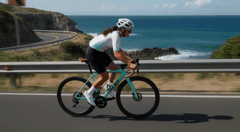
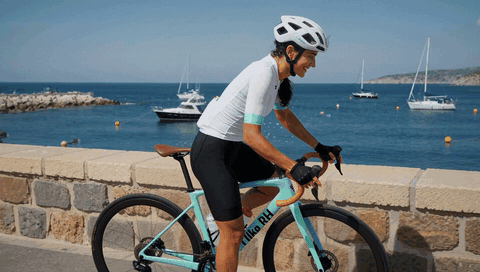
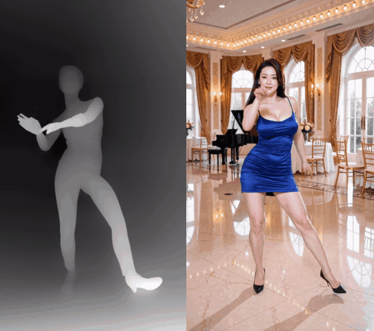
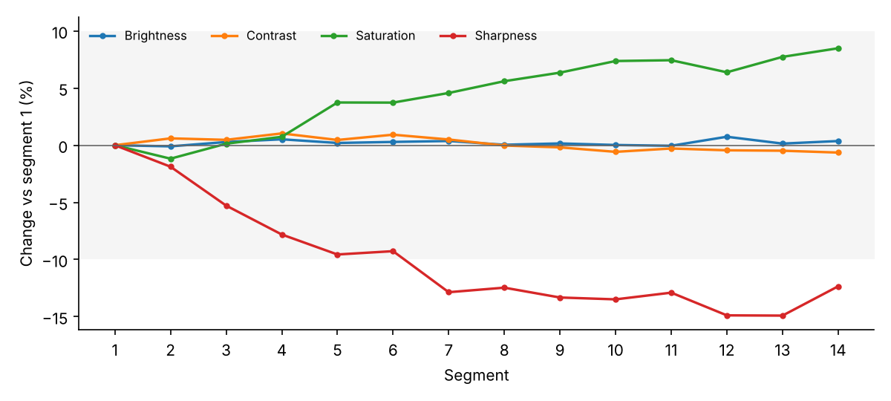

# H3MD Director · H3MD 导演台

[English](README.md) | **中文**

在 ComfyUI 里用 MiniMax H3 做长视频、多镜头视频——**一次生成 2 分钟以上的 1080p**。在可视化导演台里排镜头，逐段生成，
每段做完就存进硬盘，哪段坏了只修哪段。

> H3MD **不包含**任何 MiniMax H3 权重；模型有它自己的许可证（见 [NOTICE.md](NOTICE.md)）。

## 样片

| 2K 单段直出（2560×1408，15 秒） | 1080p 长视频（1920×1088，2 分 29 秒，节选） |
|:---:|:---:|
|  |  |
| **多镜头叙事**（1080p，2 分 19 秒，节选） | **动作复刻**：深度图 → 成片（1088×1920，2 分 13 秒，节选） |
|  |  |
| **MV**：跟锁定的歌曲对口型（1920×1088，2 分 40 秒，节选） | **MV**：空镜，歌声继续（节选） |
|  |  |

## 亮点
- **一次生成长视频**：2–3 分钟、1088×1920，自动拆成无缝续接的段。
- **坏了只修那几段**：`rerun_segments` 只重跑有问题的段，两头锁住前后段。
- **动作复刻**：参考视频只提供动作（深度图 + SAM3 + Fun ControlNet），长相来自你的照片。
- **长视频不漂色**：`lowres_anchor` 让单场景长镜头从头到尾颜色和人脸都稳定。
- **按你的显卡来**：按显存自动拆段、高清条带分块、硬盘缓存和断点续跑；可选的 4B + ClipProj 编码器能省十几 GB。

## 安装

> [!IMPORTANT]
> **安装：在终端里运行下面两行命令，然后重启 ComfyUI：**
>
> ```bash
> cd ComfyUI/custom_nodes
> git clone https://github.com/1113800942/comfy-h3md-director ComfyUI-H3MD-Director
> ```
>
> 也可以用 [comfy-cli](https://github.com/Comfy-Org/comfy-cli)：`comfy node install comfyui-h3md-director`，
> 或者 ComfyUI-Manager → **Custom Nodes Manager** → 搜 **H3MD Director**。

1. 不需要 `pip install`。
2. ComfyUI 需要支持 MiniMax H3 的版本（建议 0.43 或更新）。
3. 打开示例工作流：ComfyUI **模板 / Templates** → `ComfyUI-H3MD-Director`，或者把
   [`example_workflows/`](example_workflows) 里的文件拖进 ComfyUI。**第一次用请先开 `H3MD Director simple`（v0.3 清爽版）**：
   画布上只有三样——**总控台**（尺寸、帧数 / 插帧、修脸、种子、跑哪几段、风格按钮 均衡 / 高动态 / 动作复刻、低清和高清两张
   LoRA 表）、**导演台**（素材、分镜、提示词）和成片预览。模型、采样、保存的设置都收在子图里（点开就能改）。
   `H3MD Director` 是以前的完整平铺版。
   硬件：40 / 50 系显卡，**显存最低 16 GB，推荐 24 GB 以上**（在 RTX 5090 上实测；16 / 24 GB 的实测反馈欢迎告诉我们）。
   在 RunningHub 等进出子图不方便的平台上，先把子图释放（右键子图节点 → 解包 / Unpack）再改。用时和依赖表见下面 **更多内容**。
4. 缺节点包：ComfyUI-Manager → **Install Missing Custom Nodes**。缺模型：看工作流里的 **模型下载** note，每个文件都有下载链接和存放文件夹。
5. **提示词：请用 [H3MD 提示词 skill](skills/h3md-prompt/SKILL.zh-CN.md) 来写。** 每个镜头都是一份完整的官方 H3 提示词，
   再加上 H3MD 的规则（5+17n 长度、重叠、自动拆段、标签编号、动作复刻）。在 Claude Code、Codex、Cursor 等能读
   `SKILL.md` 的工具里安装，和 MiniMax 官方的 `h3-prompt-writing` 一起用：
   ```bash
   npx skills add https://github.com/1113800942/comfy-h3md-director --skill h3md-prompt
   npx skills add https://github.com/MiniMax-AI/MiniMax-H3 --skill h3-prompt-writing
   ```
   没有这类工具：把 SKILL 文件内容贴给任意聊天 AI，让它照着写分镜。
6. **最快跑通：示例包。** 下载
   [`H3MD_demo_bluedress_seg1.zip`](https://github.com/1113800942/comfy-h3md-director/releases/download/0.2.0/H3MD_demo_bluedress_seg1.zip)
   （1 个 12 秒镜头，图、音乐、全部设置都在里面）。在 H3MD 导演台点 **Import plan…** → 选这个 zip →
   **Plan + all settings** → 运行。两段式采样（低清 + latent 放大）在 Loop 节点内部自动完成，其他都不用调。
7. **共享 / 服务器上的 ComfyUI**（用 `--listen`、局域网地址或云平台启动）：H3MD 只读取 ComfyUI 的 input / output / temp
   文件夹里的素材，视频只保存到 output 文件夹里，缓存放在 ComfyUI 的 temp 文件夹（每次运行单独一份，计划导入上限 1 GB）。本机使用（默认 `127.0.0.1`）不变。
   可以用环境变量 `H3MD_PATHS=local` / `H3MD_PATHS=shared` 强制指定；`H3MD_MEDIA_DIRS` 可以额外允许素材文件夹。

## 快速开始
1. 在导演台里放好照片、参考视频和音乐，每个镜头写好提示词（用 [H3MD 提示词 skill](skills/h3md-prompt/SKILL.zh-CN.md)）。
2. Loop 节点上 `stop_after = 1`，先只跑第 1 段，看画面和速度。
3. 改回 `0`，`resume_from_cache` 打开：第 1 段从缓存取，其余段接着生成。
4. 某段坏了？在 `rerun_segments` 填段号（如 `8-10`）再跑一次，只重跑这几段。

```
H3MD Director --plan--> H3MD Loop Sampler（+ H3MD Loop Options）--long video--> H3MD Save Video Interp
```

## 无接缝长视频（窗口模式，测试版）
在导演台顶部勾选 **无接缝长视频**。计划完全不用改，变的只是生成方式：
* 互相续接的镜头放在**同一条时间线上一起生成**（相互重叠的上下文窗口），**没有续接接缝**，也不会一段段漂移。
* 硬切照常是硬切（窗口在切点断开，不会把前后画面混在一起）。
* 很长的计划会分成几组（每组约 60 秒），**只在硬切处分组**——硬切本来就换画面，看不出接缝。一个连续镜头比一组还长时，导演台会提示在哪里加一个硬切。
* 每个镜头的提示词、参考图、参考视频、音乐只管自己的时间段；参考视频超过 H3 约 15 秒的上限也能用（每个窗口拿自己那一段）。
* 长镜头里的台词、歌词和动作：写上从镜头开头算起的时间，用平常的写法（`At 00:07.9 she sings: <d>[English] ...</d>.`）或 `[8s] ...`；每一条只交给含那一秒的那个窗口，不会唱两遍、演两遍（见提示词 skill）。
* 同一条连续镜头里，每个镜头只靠自己的文字：场景、光线、服装在每个镜头（包括续接镜头）里都写全，大的变化写上时间。连续镜头里的大变化（转身、背影变正面、换机位）在两个窗口重叠处可能出现短暂叠化（两人 2 分 20 秒 MV 实测）；这类变化最好放在硬切处。
* 自动关闭：深度图 / 骨骼图控制（视频改作普通参考视频；选动作复刻时也关闭）、RefMod（人物一致性靠参考照片）。
* `"preview": true` 只跑低清（约省一半时间，之后的完整版直接复用）；`"redraw": [[4, 8]]` 只重画已完成视频的第 4–8 秒（换种子），其他部分一帧不变，旧版本留在缓存文件夹里。
* 内存：结果按约 10 秒一块解码并直接写进缓存，高清条带按窗口估算，2K 在 64 GB 内存上能跑（RTX 5090 实测 2560×1408、21 秒用 41 分钟）。
* 锁定的歌如果同时是 `<Audio N>`，每个窗口只带自己那一段（不再整首都带）；只改高清设置（高清 LoRA、高清窗口）时，直接用已经跑完的低清结果。
* 窗口模式下，段号（`segments_to_run`、`rerun_segments`、`stop_after`）指的是**组**，以导演台说明里列出的为准（一组 = 一起生成的几个镜头）。
* 比原来的链路慢约 25%。取消勾选就完全回到原来的方式。

## 更多内容（点开查看）

<details>
<summary><b>这个节点包做什么</b></summary>

* **多段续接**：`H3MD Loop Sampler` 按导演台的计划把所有镜头/分段跑完。续接的镜头用上一段最终 latent 的尾巴做重叠
  前缀（`overlapIn` 22 或 39 帧，drift 方式：采样中轻微重噪、最后精确还原），硬切（`overlapIn` 0）则独立生成。超过
  token 预算的镜头会自动拆成子段。
* **两段式采样（自带，不用另装）**：每段都走 `H3MD Sampler`，内置 Luna-H3-Sampler 引擎（GPL-3.0）：先低清跑前几步，
  用学习型 H3 潜空间放大器放大，再高清跑完。音频在两遍里是同一条轨迹。
* **高清自动分块**：`highres_tiling`（默认开）每段先测空闲显存，放得下就整帧跑，放不下就切成最少的条带；万一爆显存，
  会自动多切几条重跑高清阶段（低清结果保留），并记住这台机器的情况。
* **硬盘缓存 + 断点续跑**：`cache_mode = disk`（默认）时每段采样完立刻解码写进硬盘，内存里一次只有一段；打开
  `resume_from_cache` 后重新排队会跳过已完成的段，seed 自动沿用上次那次运行的。
* **流式出片**：`long video` 输出 → `H3MD Save Video Interp`，从缓存一段一段读帧、（可选）RIFE 插帧、编码写文件。
* **导演台**：`H3MD Director` 自带可视化编辑器（素材库、时间线、镜头标签页、@ 引用素材，图片标签带缩略图）。
* **动作复刻**：`H3MD Depth Control` 把参考视频转成深度图 / SAM3 人物剪影，走 Fun ControlNet + `<Video N>`。

</details>

<details>
<summary><b>安装细节和依赖</b></summary>

1. 把整个文件夹放到 `custom_nodes/ComfyUI-H3MD-Director`
   （`git clone https://github.com/1113800942/comfy-h3md-director custom_nodes/ComfyUI-H3MD-Director`，或直接复制）。
2. 按下表安装需要的节点包，然后重启 ComfyUI。
3. 不需要额外 `pip install`：H3MD 只用到 ComfyUI 自带的 torch、numpy、PyAV、Pillow、einops。
4. 下载学习型潜空间放大器（推荐）放到 `models/latent_upscale_models/`：`minimax_h3_latent_upscaler_3d_fp16.safetensors`
   或它的微调版（如 `h3_upscaler_sharpness_2000steps_v0.1_fp32.safetensors`）。不放也能跑（`upscaler_model = none`，最近邻放大，效果差一些）。

**示例工作流**
* `H3MD Director simple.json`（清爽版，**推荐从这里开始**）：总控台 + 导演台 + 预览，模型 / 采样 / 保存收在子图里；不用
  rgthree、Crystools、easy-use、LayerStyle、TE-Speed 这些节点。小显存：把 32B 编码器换成 4B + ClipProj（完整版里 ClipProj 节点默认旁路，见下面“文本编码器怎么选”）。
* `H3MD Director.json`（完整版）——样片用的完整设置，多了修脸、RIFE 补帧到 48 fps、多 1 步精修和几个方便的小工具。

| 节点包 | 在工作流里做什么 | 要不要装 | 不装会怎样 |
|---|---|---|---|
| ComfyUI 0.43+（自带 MiniMax H3 节点） | 模型、采样器、VAE | **必需** | — |
| H3MD Director（本包） | 导演台、循环采样、保存、深度 / SAM3 动作复刻 | **必需** | — |
| [ComfyUI-KJNodes](https://github.com/kijai/ComfyUI-KJNodes) | SageAttention 和 FeedForward 分块补丁（省显存） | 推荐（清爽版和完整版都用） | 能跑，但显存占用更高；SageAttention 补丁还需要装 SageAttention 包，没装就把那个节点绕过 |
| [ComfyUI-ClipProj](https://github.com/nicolab28/ComfyUI-ClipProj) | 4B 文本编码器投影，省 10 GB 以上显存 | 只有用 4B 编码器时需要 | 改用 32B 编码器 |
| [ComfyUI-VFI](https://github.com/GACLove/ComfyUI-VFI) | `H3MD Save Video Interp` 里的 RIFE 补帧 | 可选 | `interpolate` 保持关，输出 24 fps |
| [ComfyUI-VOSR2](https://github.com/ylchen333/ComfyUI-VOSR2)（清爽版）/ TE-Speed-VOSR2（完整版） | `H3MD Save Video Interp` 里的修脸 | 可选 | `face_refine` 保持关（默认就是关） |
| [ComfyUI-SeedVR2_VideoUpscaler](https://github.com/numz/ComfyUI-SeedVR2_VideoUpscaler) | 修脸选 `refine_model = SeedVR2` 时用：它的 DiT / VAE 加载节点接保存节点的 `seedvr2_model` / `seedvr2_vae`（TE-Speed 加速版也能接） | 可选 | 用 VOSR2，或 `face_refine` 保持关 |
| T8 语义桥（MiniMax H3 prompt enhancer T8） | 它的"语义桥 / 模型与设置"或多桥组合可以直接接 Loop 的 `semantic_bridge`（计算和我们自己的语义桥节点一样） | 可选 | 用我们的 H3MD 语义桥节点 / 总控台 |
| [ComfyUI-YCNodes-MiniMax-H3](https://github.com/yichengup/ComfyUI-YCNodes-MiniMax-H3) | `H3SigmaRefiner`：多 1 步精修 | 可选 | 用普通 `BasicScheduler` |
| [rgthree-comfy](https://github.com/rgthree/rgthree-comfy) | Power Lora Loader（一个节点挂多个 LoRA） | 仅完整版，可选 | 清爽版的总控台自己加载 LoRA |
| ComfyUI-Dehypnotic、Crystools、Easy-Use、LayerStyle、CRT-Nodes | 比例选择、开关、数值、清显存、计时 | 仅完整版，可选 | 出片用不到 |

修脸和补帧的节点包只有在打开这两个功能时才会用到，没装也不影响保存节点。
缺哪个节点包，ComfyUI 打开工作流时会列出来（ComfyUI-Manager → **Install Missing Custom Nodes**）。

</details>

<details>
<summary><b>硬件要求和用时（实测）</b></summary>

测试机只有一台：**RTX 5090 32 GB**、Ryzen 9 9950X3D、**64 GB 内存**、ComfyUI 0.43、PyTorch 2.13 + CUDA 13.0；
hybrid b25-49 int8 底模、32B int8 文本编码器、4 步加速 LoRA、两段式采样（低清 6 步 + 高清 3 步）。

| 分辨率 | 每段约 15 秒 | 2 分 40 秒整片 | 高清分块 | 内存峰值 | 硬盘缓存（整片） |
|---|---|---|---|---|---|
| 704×1280 | 约 4 分钟 | 47 分钟（12 段） | 1–2 条 | 约 54 GB | 约 22 GB |
| 1088×1920 / 1920×1088 | 约 8–12 分钟 | 约 1.5–2 小时（11 段） | 2–3 条 | 约 35 GB | 约 70 GB |

* 每次开跑的第 1 段会多 1 分钟左右（加载模型）。
* 模型文件：底模 19.5 GB；32B 编码器 25.3 GB（或 4B 编码器 5.3 GB + ClipProj 0.5 GB）；视频 VAE 4.9 GB；
  音频 VAE 0.6 GB；加速 LoRA 每个 0.3–1.8 GB。模型大约 55 GB，另外留出缓存空间。
* **4B 编码器 + ClipProj 对比 32B**（704×1280，同一个种子）：画质一样，速度也一样（每段 203 秒对 199 秒）；
  只是省显存（10 GB 以上），对很细的提示词稍微没那么听话。
* 1088×1920 下每 243 帧缓存约 3 GB（fp16）；出片后可以用 `delete_cache_after_save` 删掉。
* **只在 RTX 5090 上测过。** 显卡小的话，先用 4B 编码器 + ClipProj、704×1280、每段 10 秒左右、参考图少而小
  （见 **小显存**）。分块估算在第一次爆显存重试后会记住你的显卡。
* 欢迎在 [Discussions](https://github.com/1113800942/comfy-h3md-director/discussions) 里报你的显卡、分辨率和每段用时，
  我们会补进这张表。

</details>

<details>
<summary><b>保存和分享计划（Export plan / Import plan…）</b></summary>

导演台计划栏上方单独一行（空白导演台也显示）：
* **Export plan + media**：一个普通 `.zip`，里面有计划、整张工作流（所有节点设置：LoRA 和权重、种子、Loop Options、
  保存设置）、一份可读的参数清单、最新成片的第 1 帧缩略图，以及照片和歌。自己用：跑出满意效果后存下来，下次打开换张照片、
  改改时长再跑。超过 200 MB 的参考视频要勾选 "incl. big ref video" 才放进去。
* **Export plan (no media)**：同样的内容，不带照片和歌，用来分享配方，不外传别人的照片和音乐。
* **Import plan…**：打开上面导出的 `.zip`，或者智能体按 [H3MD 提示词 skill](skills/h3md-prompt/SKILL.zh-CN.md)
  （12b 节）写出来的计划 `.json`。素材放进 `input/H3MD_plans/<名字>/`（不会覆盖已有文件）。**Plan only** 只替换当前
  导演台的计划；**Plan + all settings** 用 ComfyUI 正常的加载流程在新标签页打开保存的工作流，缺的节点照常显示红色，
  缺的模型照常弹下载窗口。发现的问题（长度不是 5 + 17n、重叠不对、`<Picture N>` 没有对应图片、缺文件）逐条列出，
  不会悄悄替你改。

包里不放：成片视频、缓存、模型、RefMod 文件（在 `manifest.json` 里列出）。格式说明：
[docs/plan_format.md](docs/plan_format.md)。

</details>

<details>
<summary><b>只重跑有问题的段（rerun_segments）</b></summary>

片子跑完后如果某几段有问题（跳变、穿帮），不用整片重做：
1. 保持 `resume_from_cache` 打开，其他设置不变；可以改参考图、提示词（**总长和参考图像素尺寸保持不变**，否则自动拆段会变）。
2. 在 Loop 节点最上面的 `rerun_segments` 填要重跑的段，从 1 数，和日志里的“segment 8/16”一致：如 `3`、`4-6`、`8-10, 13-14`。
3. 每一块的开头接上一段的结尾；结尾的 39 帧锁成下一段的旧开头（高清、低清、音频都锁），所以下一段及以后一帧不动。
   选了最后一段，或下一段是硬切时，不锁结尾。连续的几段请一起选（如 8-10），被锁的那一头必须是好的。
4. 其余段直接从缓存取，输出仍是完整视频。被重跑段的旧文件挪到缓存文件夹里的 `_replaced_<时间>` 留底。
5. `rerun_new_seed`（默认开）：重跑的段用新的随机种子，提示词和参考图没改也能抽到不同结果。
开跑前日志会列出每段是“cache”还是“RERUN（head/tail）”；缺缓存时直接报错并列出缺哪几段。

</details>

<details>
<summary><b>长视频漂移和 lowres_anchor</b></summary>

这是 H3 一段接一段续写的共性问题（各家续写节点都有），只能压住、不能根除。实测 16 段：饱和度 0.32→0.46，锐度明显上升。
颜色漂移在**低清阶段**就产生了（模型续写自己的结果），表现为 24 个 latent 通道的均值和幅度慢慢偏移。
* 单一场景的长视频（动作复刻、长镜头）：`H3MD Loop Options` 末尾的 `lowres_anchor` 设 1。每个续接段低清跑完、放大前，
  新画面的通道统计拉回本镜头第一段，低清接续数据也一起校正，偏差不会传到下一段。需要 `continue_lowres_prefix = native_lowres_carry`。
  场景本该变色的叙事视频不要开（硬切后会以新镜头的第一段为准）。
* v0.2.0：`hires_anchor`（现在是 `H3MD Loop Options` 最后一项）对高清结果做同样的校正（下一段也从高清结果接续）。单独效果小
  （同一种子前 5 段：色差 0.29 → 0.13，锐度 −10.6% → −7.6%，饱和度不变），所以默认关。
* v0.2.0：保存节点（H3MD Save Video Interp / Face Refine）上的 **`drift_correct = auto`** 在写成片时、在像素层面把剩下的
  漂移拉回来。缓存不变，关掉再存一次就能对比。
  * **怎么判断。** 硬切一定换新参照。同一个镜头里，亮度、对比度或色调明显变了（天黑、室内到室外）也换新参照：漂移不会
    这样变（3 分钟长镜头 14 段里亮度变化不到 0.7%、对比度 1%、色差小于 1）。然后在同一个参照下，只有饱和度、锐度呈现
    清楚、稳定的趋势（每段都多一点）时才校正；随画面内容忽高忽低的（跳舞、有人进出）不动。只去掉漂移本身，并按相邻段
    平滑；锐度只往回补，从不弄糊。1–2 段的不动。每段的判断和理由写在 `<视频>_drift.json`。
  * **实测。** 3 分钟一镜到底（经保存节点从缓存重存）：饱和度 +8.4% → 最多 +1.5%，锐度 −18% → 最多 +3.1%，亮度、
    对比度不变。11 个镜头全是硬切的 MV：一帧没动。16 段跳舞（动作复刻）：只轻微收色 2–6%，锐度不动。合成的白天变黑夜：
    夜景被认成新场景，保持是黑的。这是根据测量做的判断，不保证都对：看报告，判断错了就关掉。
  * 已经做好的成片（或不是 H3MD 做的视频）：[`tools/drift_correct.py`](tools/drift_correct.py)
    `video.mp4 --segments 294,362,362,362:0,362`（`:0` = 硬切）或 `--plan 工作流.json`（没有自动拆段的计划）。
  * 同类做法：matlowai 的 ComfyUI-MAINodes（H3 Delta Color Carry）和它的上游 NikoDemon80 / ethanfel 的
    ComfyUI-MiniMaxH3-Contex-Loop（latent_color_carry）也是"在画面上拉回第一个场景"，它们是在下一段生成*之前*校正接续部分。
    这里没有用它们的代码。
* 其他建议：每段都放参考照片锚定身份和颜色；参考照片不要太浓太锐；提示词少写打光形容词（glowing、radiant 等）；
  特别长的片子在自然切点用参考照片重新起。


**实测：3 分钟一镜到底**（[视频](https://youtu.be/ewb1Ui5OIfs)）。3 分 07 秒，机位固定，不剪辑：14 段通过 39 帧
latent 重叠接续，704×1280，`lowres_anchor = 1`。每段都和第 1 段比，用的是 [`tools/drift_report.py`](tools/drift_report.py)
（你也可以拿它测自己的视频）：

| Segment | Time | Brightness % | Contrast % | Saturation % | Sharpness % | Colour shift |
|---:|---|---:|---:|---:|---:|---:|
| 1 | 0.0–12.2 s | +0.0 | +0.0 | +0.0 | +0.0 | 0.00 |
| 2 | 12.2–25.7 s | -0.1 | +0.6 | -1.2 | -1.9 | 0.24 |
| 3 | 25.7–39.2 s | +0.3 | +0.5 | +0.1 | -5.3 | 0.31 |
| 4 | 39.2–52.6 s | +0.5 | +1.0 | +0.7 | -7.8 | 0.29 |
| 5 | 52.6–66.1 s | +0.2 | +0.5 | +3.7 | -9.6 | 0.31 |
| 6 | 66.1–79.5 s | +0.3 | +0.9 | +3.7 | -9.3 | 0.35 |
| 7 | 79.5–93.0 s | +0.4 | +0.5 | +4.6 | -12.9 | 0.45 |
| 8 | 93.0–106.5 s | +0.0 | -0.0 | +5.6 | -12.5 | 0.49 |
| 9 | 106.5–119.9 s | +0.2 | -0.2 | +6.4 | -13.3 | 0.58 |
| 10 | 119.9–133.4 s | +0.0 | -0.6 | +7.4 | -13.5 | 0.72 |
| 11 | 133.4–146.8 s | -0.0 | -0.3 | +7.4 | -12.9 | 0.69 |
| 12 | 146.8–160.3 s | +0.7 | -0.4 | +6.4 | -14.9 | 0.63 |
| 13 | 160.3–173.8 s | +0.1 | -0.5 | +7.7 | -14.9 | 0.74 |
| 14 | 173.8–187.2 s | +0.4 | -0.6 | +8.5 | -12.3 | 0.69 |



* 亮度、对比度的变化都在 1% 以内；颜色偏移小于 1（肉眼看不出）。
* 饱和度慢慢上升约 8.5%，大约 2 分钟后基本不再涨。作为对照，同样的链式接续**不开** `lowres_anchor` 时，饱和度从
  0.34 涨到 0.48（约 +40%）。
* 锐度下降 10–15%：画面略微**变柔**，不是变锐、变老。第 1 段是纯音乐前奏、动作少，所以它本来就最锐。
* **不可能做到完全不劣化**，但 3 分钟里人脸、场景、光线都保持一致。想确认的话，用这个脚本测你自己的设置。

</details>

<details>
<summary><b>动作复刻（depth）的规则</b></summary>

* 视频勾了 depth，就**只驱动深度 ControlNet，不当 `<Video N>` 参考**（自动，没有开关）。导演台里它也不占 `<Video N>` 编号。
  原因：黑底剪影当参考时，模型会把黑底或灰色影棚照搬进画面。勾了原声的深度视频例外，仍是 `<Video N>`（日志警告）。
* 勾了 depth 却没接 `H3MD Depth Control`，开跑前直接报错。
* **参考照片不要用纯色/灰色影棚背景**（实测：关掉 `<Video>` 参考后，灰底照片仍会把画面拉灰）。用真实场景照片，或把人物抠出来放在模糊的目标场景上；
  全身照最好不露地板，地板在提示词里只写一种（纯色无纹理最稳）。

</details>

<details>
<summary><b>主要功能怎么用</b></summary>

**导演台 `H3MD Director`**
* `plan_json` 是唯一的数据源，编辑器读它、改完写回它；右上角可在 Editor / JSON 之间切换。
* 素材库（图片 / 视频 / 音频）：上传、或从 `input/` 文件夹选文件，拖到镜头上即可分配。
* 镜头长度是 5+17n 帧（24 fps）。有参考视频的镜头，长度跟着视频走。宽高会对齐到 64 的倍数（低清阶段正好是一半）。
* 提示词里输入 `@` 或点标签按钮插入素材标签（`<Picture N>` / `<Video N>` / `<Audio N>`），编号顺序就是后端实际用的顺序。
* **写提示词前先看清每张 `<Picture N>` 是什么**（标签按钮上有缩略图）：人物、服装、场景要分别对应到真正包含它的那张图。
  把空场景图写成“人物”会让画面中途跳到别的背景或服装。`skills/` 里有中英文写法说明。

**`H3MD Loop Sampler` + `H3MD Loop Options`**
* 主节点：模型、采样器、sigmas、seed、cfg、`transition_step`（低清跑几步）、`lowres_scale`、`rho` / `w_min` / `w_max`、
  `upscaler_model`、`seed_mode`（默认 increment：第 k 段用 seed + k）、`highres_tiling`、最上面的 `rerun_segments` / `stop_after` / `rerun_new_seed`、
  `cache_mode`、`resume_from_cache`。
* 高级开关在 `H3MD Loop Options` 里，接到 `options`；不接 = 全部默认值。节点默认只显示常用项，勾“高级选项”显示全部。
* 输出：`latent`、`images`（只是 64x64 占位图）、`audio`、`frame_count`、`summary`（每段的 seed、分块、每步耗时）、`long video`。
* **`long video` 要接 `H3MD Save Video Interp`**——这是唯一按有限显存/内存设计的出片路径。

**硬盘缓存**
* 缓存文件夹：`resume_<hash>`（打开 `resume_from_cache` 时固定，能断点续跑）或 `run_<时间>_<pid>`。
* 位置：`cache_dir` 为空时自动选（已有的 `H3MD_cache` → 剩余空间最大的本地盘）。
* Loop 自己不会在出片前删缓存。要删就在 `H3MD Save Video Interp` 打开 `delete_cache_after_save`（视频完整写好后才删）。
  1088x1920、243 帧一段大约 3 GB（fp16）。

**`H3MD Save Video Interp`**
* H3 固定 24 fps。开插帧时从 24 插到 `target_fps`；不插帧又把 `target_fps` 设成非 24，声音会对不上（日志会警告）。
* `format`：`video/h264-mp4`（默认）、`video/h265-mp4`、`image/gif`、`image/webp`、`image/png-sequence`（后三种没有声音）。
* chunk 大小按空闲显存/内存自动决定；显存不够会自动减半重试，最后退到 CPU。

</details>

<details>
<summary><b>小显存</b></summary>

* **高清阶段**：`highres_tiling` 保持打开。它按空闲显存自动决定切几条（最多 12 条），放得下就整帧，不会白白变慢。
  爆显存时会自动多切几条重跑；切到最多还不行，就再打开前馈分块重跑一次；仍然不行才报错，并提示怎么调。
* **低清阶段**：没有分块。爆显存时会提示在 H3MD Loop Options 里把 `ff_chunk_rows` 设成 8192（前馈按行分块，结果不变，稍慢）。
* **参考素材占的显存不会随切条变小**：参考图、参考视频、音频和文字在每一条里都是整份的。实测 1088x1920、带 2 张图 +
  1 段参考视频，每条里约 3.7 万行是这些固定内容。所以 **16 GB 以下的卡请用较低分辨率**（如 768x1344 或更小）、
  较短的段（`length` 小一些）、更少/更小的参考素材。
* **模型权重**：交给 ComfyUI 自己的显存管理（DynamicVRAM、`--lowvram`、`--reserve-vram N`）。H3MD 的 LowVRAM LoRA Loader
  可以按 token 分块加载 LoRA。
* `unload_idle_models`（默认开）在两遍之间、每段之间卸载文本编码器 / VAE 等闲置模型；`vram_release = deep` 段间还会清理缓存。
* 显存估算按 RTX 5090 32 GB 实测校准；你的机器第一次爆显存后会被记进 `user/h3md/tiling_calibration.json`，之后自动多切几条。

</details>

<details>
<summary><b>模型清单</b></summary>

示例工作流顶层有一个 `models` 数组（ComfyUI 工作流规范，<https://docs.comfy.org/specs/workflow_json>），每条有
`name`、`url`、`directory`（必填）和 `hash` / `hash_type`（可选）。ComfyUI 前端打开工作流时，如果 `models/<directory>/`
里没有这个文件，就在“缺少模型”弹窗里显示下载按钮。限制：只接受 Hugging Face / Civitai 地址；扩展名只能是
`.safetensors` / `.sft` / `.ckpt` / `.pth` / `.pt`；`directory` 必须是已注册的模型文件夹；**`name` 必须和节点里选的文件名
完全一致**，否则那一条不会显示。

| name | directory | source |
|---|---|---|
| `minimax_h3_hybrid_fl2va_ref2va_b25-49-int8.safetensors` | `diffusion_models` | huggingface.co/smhfacct/Minimax-H3-fl2va-ref2va-hybrid-models |
| `Huihui-Qwen3-VL-4B-Instruct-abliterated-int8_convrot.safetensors` | `text_encoders` | huggingface.co/ahmed22xa/Huihui-Qwen3-VL-4B-Instruct-abliterated-comfy |
| `minimax_h3_video_vae_fp16.safetensors` | `vae` | huggingface.co/Comfy-Org/MiniMax-H3 |
| `minimax_h3_audio_vae_fp32.safetensors` | `vae` | huggingface.co/Comfy-Org/MiniMax-H3 |
| `mmh3-4b-ClipProj-v3.1-mlp.safetensors` | `clip_projections` | huggingface.co/NicoLab28/ClipProj-MiniMax-H3 |
| `h3_upscaler_sharpness_2000steps_v0.1_fp32.safetensors` | `latent_upscale_models` | huggingface.co/Alissonerdx/Minimax-H3-ComfyUI |
| `H3_Combat_V2.safetensors` | `loras` | huggingface.co/JOKER141/MiniMax-H3-Combat-Base-V2 |
| `minimax_h3_DMAD_4step_full_lora_avg_rank_39_bf16.safetensors` | `loras` | huggingface.co/Kijai/MiniMax-H3-experimental |
| `minimax_h3_fl2v_turbo_4step_v1.2_768p_comfyui_bf16.safetensors` | `loras` | huggingface.co/lightx2v/Minimax-h3-Turbo |
| `minimax_h3_lms_v1.0_r64_r.safetensors` | `loras` | huggingface.co/RunningHubAI/rh-minimax-h3-lms-v1.0-r64-lora |

每个模型有自己的许可证，使用前请看它的模型页。`ClipProjApply` 那条只有装了 ComfyUI-ClipProj 才显示。

</details>

<details>
<summary><b>RIFE 模型（手动下载）</b></summary>

“缺少模型”弹窗只能下载到 `models/` 下已注册的文件夹，而且不允许 `.pkl`，所以 RIFE 的 `flownet.pkl` 不在 `models` 清单里，需要手动下载：节点包 ComfyUI-VFI（<https://github.com/GACLove/ComfyUI-VFI>）；模型 <https://huggingface.co/hzwer/RIFE/resolve/main/RIFEv4.26_0921.zip>，解压后把 `flownet.pkl` 放到 `custom_nodes/ComfyUI-VFI/rife/train_log/flownet.pkl`（相对 ComfyUI 根目录）。ComfyUI-VFI 第一次运行时通常也会自己下载。

</details>

<details>
<summary><b>注意事项和已知问题</b></summary>

* 走 `latent` / 外部解码出来的图片 / `audio` 这些路径处理大/长视频，**不保证**显存/内存不爆；外部一次解码整段 latent，
  接缝处也可能和 `long video` 出的片子略有不同。只有 `long video` → `H3MD Save Video Interp` 是按有限显存/内存设计的。
* `images` 输出只是 64x64 占位图（`cache_mode = ram` 例外）。
* 旧工作流：已删除的选项（`merge_images`、Save Video Interp 的 `preset` / `cache_folder` / `pingpong` / `fps` 输出等）
  加载时按名字对齐并丢弃，其他参数不错位；旧的 `H3MD Loop Sampler (legacy)` 节点保留，旧存档照常打开。
* `video/h265-mp4` 和 10-bit（`yuv420p10le`）**还没测过**。
* `resume_from_cache` 的缓存键不包括模型、LoRA 和放大器；换了这些请关掉 resume 或清掉缓存文件夹。
* 这一版换了采样引擎，旧版留下的缓存不会被续跑使用；旧工作流里的 `H3MD Loop Options` 节点请删掉重新放一个（选项变了）。
* **文本编码器怎么选**：32B（`qwen3vl_32b_minimax_h3_int8_convrot`）对提示词理解最准；显存不够就用 4B
  （`qwen3vl_4b_fp8_scaled`，Load CLIP 的 type 选 `krea2`）+ ClipProj，能省十几 GB，画质不受影响，只是理解稍弱、画面细节和
  32B 略有不同。ComfyUI 0.44 上实测（RTX 5090、64 GB）：
  它编码慢很多（每次 29 秒，32B 5 秒；窗口模式每个窗口都要编码），内存 / 显存峰值几乎一样（51 / 29.7 GB 对 50 / 30.9 GB），
  因为 ComfyUI 会从硬盘流式加载 32B。32B 根本加载不了时再用它。**同一部片子从头到尾用同一个编码器**，不要在
  `rerun_segments` 重跑时中途换。
* **快动作残影**：快速甩手、挥手时偶尔有一瞬间的残影（多只手）。原因是时间上 4 帧压成 1 帧，再加上少步数；可以用
  `rerun_segments` 换种子重跑那一段。
* 动作复刻的分镜总长会自动对齐到参考视频（5+17n 向上取整），导出后把超出参考视频的最后几帧剪掉。

</details>

<details>
<summary><b>H3MD 用到的技术和思路，以及致谢</b></summary>

MiniMax H3 单次最多十几秒。要做两三分钟的长视频，难点不在“能不能接上”，而在接了十几段之后还**不跳、不漂、不爆显存、坏了能修**。下面是我们踩过的坑和解法，欢迎拿去改进。

### 1. 用 latent 接续，不走像素
- **问题**：常见做法是把上一段解码成视频再编码回去当参考，每接一次就糊一点、偏色一点。
- **做法**：直接拿上一段**最终 latent 的最后 39 帧**当下一段的开头（noise mask = 0 锁住），采样时只给开头几帧轻微重加噪，最后再精确还原。合并时重叠部分取后一段的。

### 2. 两段式采样 + 低清原生接续
- **做法**：先在一半分辨率跑 6 步，用学习型潜空间放大器放大，再在全分辨率跑 3 步（引擎来自 Luna-H3-Sampler）。
- **低清原生接续**：下一段的低清开头直接用上一段**自己的低清结果**，不从高清缩回去，两条链各自连贯。

### 3. 按显存自动拆段、自动分块
- 每个镜头先按 token 预算估算（画面 + 参考视频 + 图片），超了就自动拆成等长的续接段，拆点尽量放在参考视频动作安静的地方。
- 高清阶段先测空闲显存，放得下就整帧跑，放不下就切成最少的条带；万一爆显存就多切几条重跑，并记住这台机器的情况。
- 慢步保护：一步突然慢 4 倍以上，说明显存耗尽、权重在来回搬，自动停下，缓存保留。

### 4. 硬盘缓存、断点续跑、只重跑坏的段
- 每段采样完立刻解码写硬盘，内存里一次只有一段；重开时跳过已完成的段。
- **重跑选定段**：选中的段开头接上一段，**结尾也锁成下一段的旧开头**（高清 latent、低清结果、音频三样都锁），所以换进去的新段两头都无缝，其他段一帧不动。不用为一处跳变重跑 5 小时。

### 5. 动作复刻：深度只驱动 ControlNet
- 激烈动作可以另外用第三方的 **TARA** 动作迁移 LoRA（Alissonerdx，配 ComfyUI-BFSNodes），当作普通节点接进 H3MD 工作流：
  原片当普通 `<Video 1>`（不勾 depth）、加 TARA LoRA、BFS 的 TARA 节点只接低清模型、提示词加 `motion_transfer:`，
  把清爽版里的「Sage 低清」节点旁路掉（Sage 会让 TARA 失效）。清爽版的模型区已经放好两个 TARA 节点（平常旁路，旁边有说明）：在总控台点「动作复刻」会自动打开它们并旁路「Sage 低清」，点「均衡」「高动态」自动恢复。TARA 不属于本节点包：请自己安装 ComfyUI-BFSNodes（Manager → 安装缺失节点）和 LoRA（缺少模型窗口里下载）。
  动作复刻的镜头长度：跟随原片的镜头，长度取原片长度，再对齐到 H3 的 5+17n 帧。提示词里有 `motion_transfer:`
  （用 TARA）时，在原片结尾处**向下取整**（TARA 要求每一帧都有原片对应，所以最多少原片结尾 0.7 秒）；**其他功能**
  照旧**向上取整**。这个长度不用自己设，提示词第一行的 `Duration:` 也会自动改成实际长度。

- 参考视频 → Depth Anything V2 深度图 → SAM3 只保留人物 → Fun ControlNet，**只作用在低清阶段**。
- **实测教训**：把黑底白人形的剪影同时当 `<Video N>` 参考喂进去，模型会把黑底、灰色影棚照搬进画面。现在深度视频只驱动 ControlNet，不当参考。

### 6. 参考照片会被“照搬”的东西（实测）
- 灰色 / 纯色影棚背景 → 视频跑进灰色影棚。解法：把人物抠出来，放到目标场景的模糊背景上。
- 照片里露齿大笑 → 视频里一直笑到僵。解法：提示词写明“身份照照片，表情不照照片”。
- 木地板、地砖、镜子这类纹理 → 每段长得不一样。解法：只写一种纯色地面。

### 7. 长视频漂移：在低清阶段按通道拉回（lowres_anchor）
- **问题**：一段接一段续写，颜色越来越深、越来越锐、人越来越显老。这是各家 H3 续写方案都有的共性问题。
- **定位**：我们把 16 段缓存里的低清结果和最终结果分开测，发现颜色漂移**在低清阶段就产生了**（饱和度 0.39 → 0.58），高清阶段只加一个固定偏移，不累积。漂移的形状很简单：24 个 latent 通道的均值和幅度慢慢偏移。
- **做法**：每段低清跑完、放大前，把新画面的通道均值和幅度拉回**本镜头第一段**的统计，低清接续数据也一起校正，误差就传不到下一段。
- **结果**：133 秒整片饱和度一直在 0.33–0.36，不开时是 0.34 → 0.48；锐度不再上涨，人不再变老。
- **走过的弯路**：一开始拿“上一段的保留帧”当标准去校正，没效果，因为那几帧本身已经漂了，等于拿漂过的对齐漂过的。**锚点必须选一个没漂的源头。**

### 8. 编码器：32B 和 4B + ClipProj
- 4B + ClipProj 能省十几 GB 显存，画质不受影响，只是对提示词的理解稍弱。从零生成完全可用；同一部片子不要中途换编码器。

### 9. 方法上的经验
- **先查社区，再做测试**：一天只能跑几次测试，别人踩过的坑先看。
- **用数字说话**：每段测饱和度、拉普拉斯锐度，再截脸对比，不靠“感觉好像”。
- **离线分析缓存**：缓存里存着每段的低清和最终 latent，不占显卡就能定位问题出在哪一步。

### 致谢 👍
H3MD 站在很多人的肩膀上。下面这些作者的代码、模型或公开分享的经验给了我们直接的思路，在这里给他们点个赞：

**引擎、模型与节点**
- 👍 [MiniMax](https://huggingface.co/MiniMaxAI) 开源 H3，[Comfy-Org](https://huggingface.co/Comfy-Org/MiniMax-H3) 做了 ComfyUI 原生支持
- 👍 [Luna-H3-Sampler](https://github.com/lunaaispace-eng/Luna-H3-Sampler)：两段式采样引擎（H3MD 内置，GPL-3.0）
- 👍 [LBH-123-AI](https://huggingface.co/LBH-123-AI/Minimax_h3_latent_Upscaler)：学习型潜空间放大器（MIT）
- 👍 [Alissonerdx](https://huggingface.co/Alissonerdx/Minimax-H3-ComfyUI)：sharpness 放大器和 lms LoRA
- 👍 [nkxx188/ComfyUI-MiniMaxH3-Easy](https://github.com/nkxx188/ComfyUI-MiniMaxH3-Easy)：高清条带分块的思路（MIT）
- 👍 [Kijai](https://github.com/kijai/ComfyUI-KJNodes)：SageAttention / FeedForward 省显存补丁，DMAD 转换
- 👍 [NicoLab28/ClipProj](https://github.com/nicolab28/ComfyUI-ClipProj)：4B 编码器投影，让小显存也能跑
- 👍 [alibaba-pai Fun ControlNet](https://huggingface.co/alibaba-pai/MiniMax-H3-Fun-Controlnet-Union)、[Depth Anything V2](https://github.com/DepthAnything/Depth-Anything-V2)、[SAM3](https://huggingface.co/Comfy-Org/sam3.1)：动作复刻的三块基石
- 👍 [smhfacct](https://huggingface.co/smhfacct/Minimax-H3-fl2va-ref2va-hybrid-models)（fl2va × ref2va 混合模型）、[t8star](https://huggingface.co/t8star)（curveproj 兼容 LoRA）、[lightx2v](https://huggingface.co/lightx2v/Minimax-h3-Turbo)（Turbo LoRA）、[DMAD](https://huggingface.co/ZhengmingYu/DMAD)、[fal](https://huggingface.co/fal/MiniMax-H3-Realism-People-LoRA)（realism people）、[JOKER141](https://huggingface.co/JOKER141/MiniMax-H3-Combat-Base-V2)（Combat LoRA）

**长视频漂移：公开分享经验的作者**
- 👍 [tritant/ComfyUI_MiniMax_H3_Extender](https://github.com/tritant/ComfyUI_MiniMax_H3_Extender)：公开记录“每接一段对比度就上升”，并指出参考图会把颜色带进来
- 👍 [NikoDemon80/ComfyUI-H3-Motion-Context](https://github.com/NikoDemon80/ComfyUI-H3-Motion-Context)：latent 接续代替像素往返，以及“最后一步少加锐度”的思路
- 👍 [mark9009/ComfyUI-H3-LongTake](https://github.com/mark9009/ComfyUI-H3-LongTake)：关键帧锚定和接缝颜色匹配的实测数据
- 👍 [EchoHeadache/comfyui-aex-drift](https://github.com/EchoHeadache/comfyui-aex-drift)：交接匹配、接缝锚定的思路。我们试过之后改成了锚定第一段，但正是它让我们想清楚“锚点要选没漂的源头”
- 👍 [roycho87/clown_context_suite](https://github.com/roycho87/clown_context_suite)：周期性干净锚点的想法
- 👍 dev.to 上 [10 段链式实测](https://dev.to/nefayran/chaining-image-to-video-clips-from-the-last-frame-what-10-links-did-to-a-face-minimax-h3-46e0) 的作者：把“脸会变老、锐度过冲”量化出来

### 特别鸣谢 👍
[t8star] [JOKER141]-Bunny [TE MAN] 等多位大佬长期为社区提供的公益教学, 他们制作了很多杰出的作品和分享了很多思路和经验, 给他们点赞!

谢谢大家把踩过的坑公开出来，H3MD 也会继续把我们的发现分享回社区。

</details>

每个节点和选项的完整说明（英文）：[docs/technical-reference.md](docs/technical-reference.md)。

## 许可证
ComfyUI-H3MD 版权所有 (C) 2026 YJ，按 GNU Affero 通用公共许可证第 3 版或更新版本（SPDX `AGPL-3.0-or-later`）发布，
附加一条：分发或作为在线服务提供时，必须保留明显的署名“基于 H3MD 导演台 / H3MD Director（ComfyUI-H3MD-Director），作者 YJ”。允许商用；修改后通过网络
提供给别人用，必须公开修改版源码。全文见 [LICENSE](LICENSE)，说明见 [NOTICE.md](NOTICE.md)；`h3md_luna/` 里自带的
Luna-H3-Sampler 代码是 GPL-3.0（[LICENSES/](LICENSES/)）。
